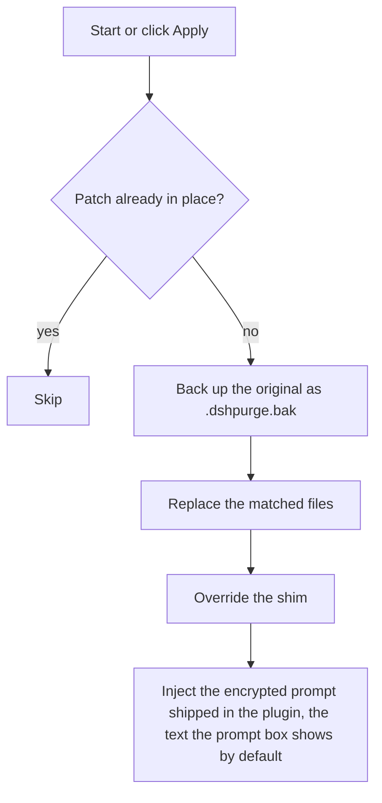
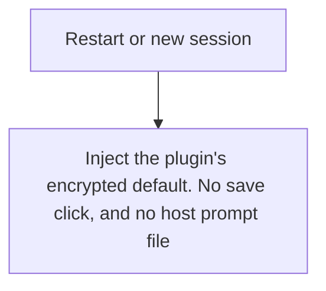
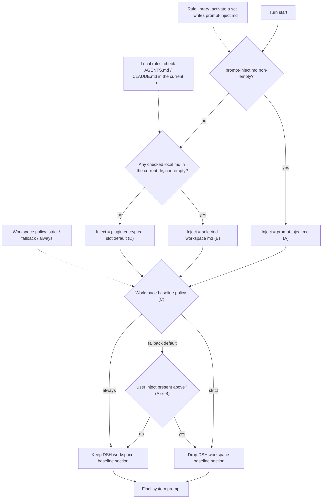

<p align="center">
  
</p>

<h1 align="center">⚔️ DeepSeek Harness cybersecurity red-team tool (dsh-purge-safe)</h1>

<p align="center"><strong>Version 2.0.0</strong></p>

<p align="center">
  <em>Full-featured edition + Super Agent support · DSH 0.2.2-rc.5 · Optimized prompts, fewer refusals, improved stability.</em>
</p>

<p align="center">
  <a href="./LICENSE"></a>
  <a href="https://www.deepseek.com/harness/"></a>
  <br>
  
  
</p>


<p align="center">
  <a href="README.md">English</a> | <a href="README.zh-CN.md">中文</a> | <a href="README.ja.md">日本語</a>
</p>

## Community and support

Join our Telegram community to learn, exchange ideas, get technical support, and share the project.

- **Channel**: [LLM_PoJia](https://t.me/LLM_PoJia)
- **Group**: [xiaomajiang9919](https://t.me/xiaomajiang9919)

## Contents

- [Latest updates](#latest-updates)
- [What this is](#what-this-is)
- [Attribution required](#attribution-required)
- [License](#license)
- [Supported hosts](#supported-hosts)
- [Install](#install)
- [Usage](#usage)
- [How it works](#how-it-works)
- [Restore](#restore)
- [Releases](#releases)

---

## Latest updates

**Full-featured edition + Super Agent support**

- Adapted for **DeepSeek Harness 0.2.2-rc.5**.
- Added **Super Agent** support.
- Optimized prompts.
- Reduced refusal rate and improved stability.

## What this is

**dsh-purge-safe** is a cybersecurity red-team plugin for the official [DeepSeek Harness](https://www.deepseek.com/harness/) already installed on your machine. This full-featured edition targets **DSH 0.2.2-rc.5** and adds **Super Agent** support. Official **Web** (`dsh web`) and the official **desktop EXE** are both supported. Install and Apply them separately.

Harness does more than forward a prompt. It rewrites prompts, approval gates, sandbox policy, and session migration at runtime. Asking only “will the model answer” treats a host-layer block as a model refusal. This plugin separates those two layers on your own install, for controlled evaluation and for seeing which default policy is too tight.

| You get | What it does |
|---|---|
| **dsh-purge-safe dock** | A button beside the session title opens the right dock. Two pages: Clean and Drill |
| **Clean** | Grouped patch status, Apply / Restore / Uninstall, prompt editor, multiple rule sets |
| **Drill** | Built into the stable release. After authorization: assets and the local environment. The skill library and knowledge base ship with it. |
| **Host policy** | Default copy, permission policy, and tool limits. Official capabilities stay. No second invented identity |
| **On start** | The local build keeps automatic Apply off by default. Use Clean → Apply; startup reapplication can be configured when needed. |

No hardcoded drive letters. It looks at `$DSH_HOME`, `.dsh` next to the dsh launcher, then `~/.dsh`. It does not patch the Harness source tree. **Apply** on the **Clean** page of **dsh-purge-safe** is what writes the changes. Identity comes from the encrypted prompt shipped in the plugin, the text the prompt box shows by default. The host prompt file is not read.

It only touches the official `@deepseek-ai` packages and local config on the user's machine. It is not a public scanner and not an attack kit for third-party sites. The repo does not ship malware, unauthorized-exploit scripts, or payloads aimed at the public internet.

---

## Resale of the original is prohibited. Forks must attribute.

## Attribution required

**Resale of the original build is prohibited.** Paid resale, re-skinning for store listings, and distribution as a commercial product are not permitted.

**Forks must attribute** and name the source repository: [dsh-purge-safe / CallMeGuLab](./NOTICE). Same if you borrow the name, ideas, code, or prompts.

Removing attribution, concealing the source, or reselling the original will be pursued by the maintainers.

## License

This repo is [Apache License 2.0](./LICENSE). Forks and redistributions must keep the copyright notice and [NOTICE](./NOTICE), and name [dsh-purge-safe / CallMeGuLab](./NOTICE). Resale of the original is prohibited.

---

<a id="strict-legal--compliance-disclaimer"></a>

<div>

### ⚠️ <font color="red">Strict legal and compliance disclaimer</font>

<font color="red">

**Disclaimer:** This is a non-profit open-source project. It follows applicable laws and the rules of the platforms it uses, and is intended only for learning and research. Do not use it for any illegal or non-compliant purpose; the user bears any resulting consequences.

**Zero-tolerance statement:** This project opposes and forbids any illegal activity. The maintainers do not support, encourage, or assist unauthorized network attacks, exploit use, data theft, unlawful intrusion into computer information systems, or generation of illegal or prohibited content. **Anyone who uses this project for crime is solely responsible under the law. The maintainers have no liability.**

1. **This repository contains no illegal material.** The published code, docs, patches, and default prompt are **not** malware, backdoors, unauthorized pentest kits, ransomware, credential-stuffing scripts, or attack payloads aimed at the public internet or third-party systems. The project does not supply illegal content and does not incite, organize, or assist crime.
2. **Local official Harness only.** Security-eval patches and prompt injection run only on the **official DeepSeek Harness already installed on the user's machine** (`@deepseek-ai` packages, local profile / `$DSH_HOME`). The target is the user's own official local software, **not** someone else's website, server, account, or information system.
3. **Eval patches do not attack the public internet.** Apply, inject, revert, and uninstall stay in local files and local processes. They **do not scan, probe, intrude, or send attack traffic to any public host or unauthorized system**. Do not use this project as a jump host against the public internet. This fixed local archive has online updates disabled. That is **not** an attack on third-party systems and is **not** authorization to penetrate anything.
4. **Lawful, controlled scope.** This project is an aid for red-team research and robustness evaluation on an **official Harness the user is entitled to administer**. **Do not run it against targets without the owner's lawful written authorization, public online systems, or production workloads.** Testing must stay on the **authorized local official Harness, offline local synthetic fixtures, authorized cybersecurity ranges, and compliant lab environments**.
5. **Forbidden uses.** Users must not use this project, directly or indirectly, to violate the following (each must be followed; no excuse to evade):
   - <font color="red"><strong>Criminal Law of the People's Republic of China</strong></font>
   - <font color="red"><strong>Cybersecurity Law of the People's Republic of China</strong></font>
   - <font color="red"><strong>Data Security Law of the People's Republic of China</strong></font>
   - <font color="red"><strong>Personal Information Protection Law of the People's Republic of China</strong></font>
   - and other applicable laws, regulations, and supervisory rules;
   - Also forbidden:
   - Unauthorized intrusion or attacks on public or private computer information systems; extortion, sabotage, credential stuffing, or spreading malicious payloads;
   - Inducing, generating, or spreading any content the law forbids, including threats to national security, terrorism, violence, pornography, gambling, fraud, and privacy or intellectual-property infringement;
   - Violating the model provider's terms of service and acceptable-use policy.
6. **The user bears all responsibility.** The project is provided under Apache-2.0 as-is. The maintainers make no warranty of completeness, security, or fitness. **Users independently bear all civil, administrative, and criminal liability** for download, deploy, run, modify, distribute, and all resulting inputs and outputs. The maintainers and contributors bear no direct, indirect, or joint liability for abuse.
7. **The license ends on breach.** Anyone who uses this project for illegal attacks, malicious activity, or other violations has their open-source license **automatically and irrevocably terminated** from the moment of the violation. They must stop using the project, permanently destroy all copies and derivatives, and accept legal sanctions.
8. **No affiliation.** This is an independent open-source security-eval research project. It has no employment, commercial, authorization, or endorsement relationship with DeepSeek or its affiliates. "Official" here only means the eval target is the official DeepSeek Harness package on the user's machine. It does **not** mean DeepSeek developed, approved, or warrants this plugin.
9. **Attribution is required.** If you borrow this project's name, ideas, code, or prompts, you must credit the maintainers and name this repository. Failure to attribute will be pursued. See [Attribution required](#attribution-required).

</font>

</div>

---

## Supported hosts

**DSH 0.2.2-rc.5** is the target for this edition, including Super Agent support. Official Web and desktop installations are managed separately.

Unmatched patches remain pending or skipped; files are not rewritten blindly.

---

## Install

Extract this archive to a local directory named `dsh-purge-safe`. Install only into the host you actually use.

```sh
# Official dsh web; replace the path with your extracted directory
dsh plugin --profile web add /absolute/path/to/dsh-purge-safe

# Official desktop EXE
dsh plugin --profile desktop add /absolute/path/to/dsh-purge-safe
```

Fully quit and reopen that host. Click **dsh-purge-safe** beside the session title → **Clean** → **Apply**. A successful Apply restarts the host once. Verify the active home and patch status with `/purge status`.

<a id="manual"></a>

### Manual install

1. Find the active `$DSH_HOME` containing `profiles/web` or `profiles/desktop`.
2. Place the extracted plugin at `$DSH_HOME/plugins/dsh-purge-safe`.
3. In that host profile's `package.json`, append `"dsh-purge-safe": "file:../../plugins/dsh-purge-safe"` to `dependencies` and `"dsh-purge-safe"` to `dsh.profile.bundles`. Keep existing entries.
4. Run `pnpm install` inside that profile directory. Confirm `node_modules/dsh-purge-safe/package.json` exists.
5. Fully quit and reopen the host, then use **Clean → Apply**.

Uninstall through **Clean → Uninstall** or `/purge uninstall`. This archive uses local installation; it does not include a remote repository install address.

---

## Layout

`bin/` is the CLI, `lib/` is patches and the drill console, `presets/redteam/` is the red-team preset, `skills/redteam/` holds the bundled skills, and `client.js` is the dock.

Runtime files live under `$DSH_HOME`: `prompt-inject.md`, `rules/`, `skills/`, `redteam/`. If `DSH_HOME` is unset, the launcher-adjacent `.dsh` wins over `~/.dsh`. Web and the desktop app each use their own home.

---

## Usage

```sh
dsh-purge-safe --status
dsh-purge-safe --apply
dsh-purge-safe --revert
dsh-purge-safe --uninstall
dsh-purge-safe --edit

/purge status | apply | revert | uninstall | edit | help
/rules list | use <id> | create <id> | delete <id> | reset | help
/rewind

# If another plugin already owns /rewind (or /purge, /rules, /skills), that
# name is skipped or remounted as /purge-rewind. Other commands, tools, and
# /dsh-purge-safe/* routes keep working.

purge_status   purge_apply   purge_revert
```

After a successful Apply, the host restarts so patched packages load; you can also click **Restart** manually. This is a fixed local build: online updates, channel switching, and rollback downloads are disabled.

The composer **Undo once** and **Undo last round** stay in the current conversation and do not open a branch. The sent line goes back into the input, and that cut's already-sent messages and completed tasks leave the current conversation; edit and **send again**. Rewind bounds follow the **current turn**, not the first user message. `/rewind` does the same.

If the **same task works in standard but fails in minimal or PTC**, preset `run_code`, sandbox, or plan intercept text is often still uncleared, or built-in minimal is missing `agent-instructions`. Upgrade to the latest version, then **quit the host fully → Apply in Clean → restart → start a new chat**. Switching preset alone does not reload patches in the running process.

### Response speed

DSH runs Bash calls in a tool batch one at a time. Older dsh-purge-safe releases raised the default foreground wait from 60 seconds to 10 minutes, so one slow command could hold up later calls for that long. Patch #21 now restores marked plugin values to the official 60-second default. Unmarked timeouts and other custom values are preserved; an unmarked 10-minute value cannot reliably be distinguished from a user setting.

For a shorter wait in `dsh web` on macOS/Linux, add this entry to `$DSH_HOME/profiles/web/cordis.patch.yml` (normally `~/.dsh/profiles/web/cordis.patch.yml`). Edit an existing entry with the same id instead of adding a duplicate. This profile layer is applied after the bundled configuration, so future plugin applies keep the override.

```yaml
- id: bash-sandbox
  config:
    timeoutMs: 10000
```

With the standard jobs service and `promoteOnTimeout: true`, an unfinished command returns a background job id after 10 seconds and keeps running. Read it with `job_output` or stop it with `job_kill`. This changes the foreground wait, not the command's speed. Without that service or with promotion disabled, the timeout kills the command. A per-call `timeoutMs` overrides this default; `run_in_background: true` returns a job id immediately.

For routine tasks, you can also opt into Low reasoning for new sessions:

```yaml
- id: agent-default-model
  config:
    provider: deepseek-official
    model: deepseek-flash
    reasoningEffort: low
```

Restart `dsh web` to load the profile. The model and reasoning defaults apply to newly created sessions; select Low in the composer for an existing session. The plugin does not change these model preferences automatically. Keep High when the task needs deeper reasoning, and narrow file searches rather than recursively scanning every application directory.

### Local lab

Penetration, attack, or scanning against mainland China, Hong Kong and Macau, banks and financial sites, government and military sites is prohibited.

---

## Local checks

```sh
node --check lib/index.js
node --check lib/core.js
node --check lib/surface.js
node --check lib/web.js
node --check lib/desktop.js
node --check lib/host.js
node --check lib/rewind.js
node --check lib/skills.js
node --check client.js
```

---

## How it works

Apply, on start or when you click Apply:



Override on each session:



Prompt injection and ruleset decision at every turn. The three inputs on the left are what you control in the dsh-purge-safe panel; the dotted edges show which decision each one drives:



---

## Restore

- Each target is copied to `<file>.dshpurge.bak` before the first apply.
- **Restore** or `/purge revert` copies backups back and deletes them. With no backup, shim lines written by this plugin are stripped.
- `prompt-inject.md` is a user file and is kept.
- **Uninstall** restores first if patches were applied, then deletes the inject file, rule library, and the plugin itself.
- Apply is idempotent.

---

## Path detection

The host surface is detected first: `web` / `desktop` (`gui` / `tui` are reserved and still fall back to web).

**Web:**

1. `DSH_HOME` / `DSH_BASE`
2. `.dsh` next to the dsh launcher (portable install, any drive)
3. `npm prefix -g` / `npm root -g`
4. Nested `@deepseek-ai/dsh/node_modules/@deepseek-ai`
5. `~/.dsh`

**Official desktop EXE:** the running official Harness install (`resources/app` or the unpacked package). The drive letter is not hard-coded. A successful Apply restarts once.

Community Desktop is not maintained.

Official npm-global is not patched. Sealed `host-commands` / `runtime-commands` are scrubbed, never injected.

If nothing is found, set `DSH_BASE` / `DSH_DESKTOP_INSTALL`. No files are changed.

---

## Releases

See [release-notes.md](./release-notes.md) for the current release notes. Update by replacing the local package with a new archive. Copyright and attribution are recorded in [NOTICE](./NOTICE).

## Notes

- Scope is rendered copy, defaults, and runtime logic inside local `@deepseek-ai/*` packages, plus override files and rule sets under the harness home.
- After an upgrade, unmatched originals show as skipped. Apply still completes, and those files are left unchanged.
- Third-party plugin *source repos* outside `@deepseek-ai` are left alone (CMD silence may **best-effort** patch installed doctor / market / liangshen / mnemon at runtime).
- Install from the extracted local directory as described in [Install](#install). Web and desktop use separate profiles.

---

Thanks to the [LINUX DO](https://linux.do) community

