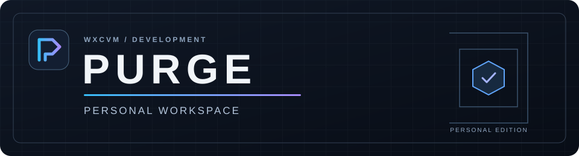

<p align="center"></p>

# PURGE · Personal Workspace

Personal development workspace for the DeepSeek Harness extension. [中文首页](README.md)

[Releases](https://github.com/wxcvm/dsh-purge/releases) · [Actions](https://github.com/wxcvm/dsh-purge/actions) · [Pull requests](https://github.com/wxcvm/dsh-purge/pulls) · [Issues](https://github.com/wxcvm/dsh-purge/issues)

## Workspace

| Area | Purpose |
| --- | --- |
| Clean | Local host status, configuration, maintenance and restoration |
| Drill | Authorized assessment project records, evidence and reports |
| Host | Desktop and Web compatibility |
| Maintenance | Version tracking, diagnostics, backup and recovery |

## Development & releases

[Release center (中文)](docs/RELEASE_CENTER.zh-CN.md) · [Development status (中文)](docs/DEVELOPMENT_STATUS.zh-CN.md)

This repository is public. Verify published assets against the corresponding Release; the main branch is not itself a release. Private deployment and update compatibility remain separate checks.

- [Package metadata](package.json): source version, dependencies, runtime requirements and scripts.
- [Releases](https://github.com/wxcvm/dsh-purge/releases): published versions and available assets.
- [Actions](https://github.com/wxcvm/dsh-purge/actions): build and test records. The [`.11` delivery ledger](docs/DELIVERY_STATUS_11.zh-CN.md) separates verified release bytes, local tests, and pending Desktop/Web device acceptance.
- [Documentation](docs/): existing guides and technical records.

```sh
npm test
npm run build:client
npm run test:all
```

Desktop and Web host environments are tested separately. Security assessments must remain within systems owned by the operator or explicitly authorized for testing.

## License & attribution

Based on [YuJunZhiXue/dsh-purge](https://github.com/YuJunZhiXue/dsh-purge). Copyright 2026 YuJunZhiXue. Retain [Apache License 2.0](LICENSE), [NOTICE](NOTICE) and attribution. The original author requests that the original build not be resold and that derivative works credit the upstream project. Changes to repository visibility do not revoke existing licenses or third-party obligations.
