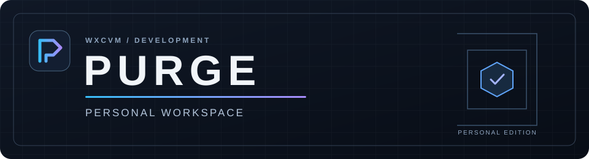
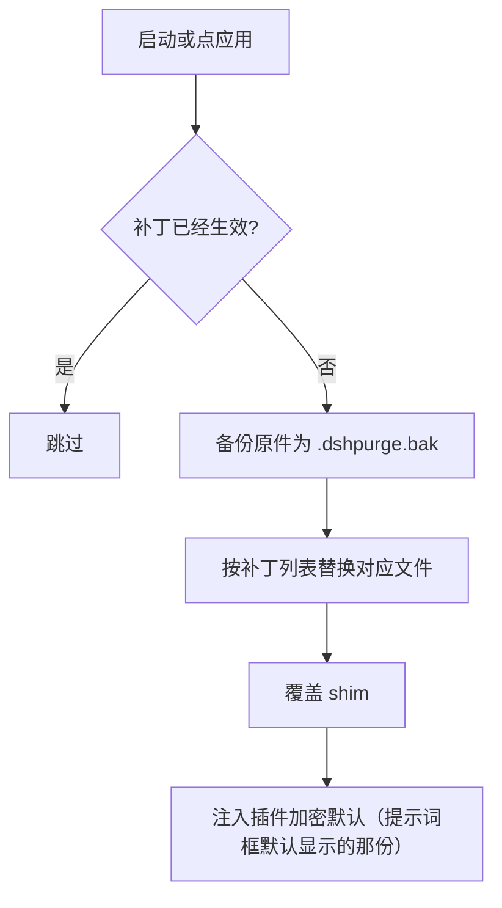
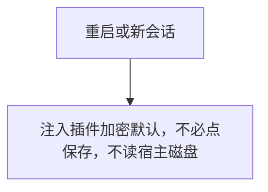
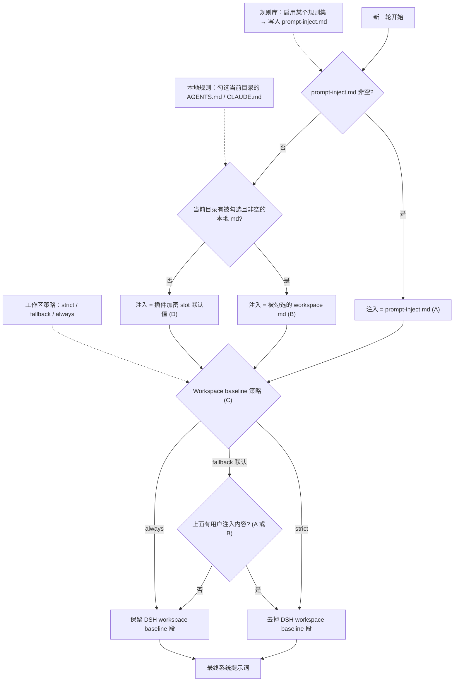

<p align="center">
  
</p>

> **私有测试候选：** 下文匿名 codeload/pnpm 安装命令属于公开仓库时期的历史示例，当前不可直接使用。请优先阅读[私有更新与迁移说明](docs/PRIVATE_UPDATE.zh-CN.md)。beta.8 已实测桌面内置检测更新；完整在线安装和 Web 更新仍需单独验收。


<h1 align="center">⚔️ DeepSeek Harness 网络安全红队工具（dsh-purge）</h1>

<p align="center"><strong>Version 1.1.92-wxcvm.7-beta.11（测试版）</strong></p>

> beta.11：修复中心、流式状态对账、取消重试竞态、原生会话绑定、数字版本更新判断。详见[发布说明](release-notes-wxcvm.md)。

> beta.10：拒答识别防误判专项。正常说明不当成软化/拒绝，交付依据独立证据；不确定不触发额外动作。详见[识别规则、回归证据与验收边界](docs/RESPONSE_ASSESSMENT.zh-CN.md)。

> 测试版跟随 `beta` 分支，正式通道 `master` 保持 `.6`。本版整合持久化任务记录、本机运行观察与导入对账、知识检索内存优化、上下文隐私、结构化错误诊断和 SQLite 概览优化。已完成 rc.3 实际桌面检测更新验收；完整在线安装仍待验证，不提供自动任务重放。详见[知识中心使用指南](docs/KNOWLEDGE_CENTER.zh-CN.md)。

<p align="center">
  <em>DeepSeek Harness 增强工具：集成清洗台、作战台、模型评测、宿主配置与任务管理。</em>
</p>

<p align="center">
  <a href="https://github.com/YuJunZhiXue/dsh-purge/stargazers"></a>
  <a href="https://github.com/YuJunZhiXue/dsh-purge/blob/master/LICENSE"></a>
  <a href="https://awesome-dsh-plugin.com"></a>
  <a href="https://deepseek.stream/plugins/dsh-purge"></a>
  <a href="https://www.deepseek.com/harness/"></a>
  <br>
  
  
</p>

<p align="center">
  <a href="https://dsh-plugin.org/plugins/yujunzhixue/dsh-purge"></a>
</p>

<p align="center">
  <a href="README.md">English</a> | <a href="README.zh-CN.md">中文</a>
</p>

## 新手操作指南（第一次使用推荐先看这里）

- **[清洗台详细操作指南](docs/CLEANING_GUIDE.zh-CN.md)**：从打开侧栏、点「应用」、看懂补丁状态，到提示词/规则集、还原、卸载与常见故障。
- **[外部分支评估记录](docs/UPSTREAM_REVIEW_2026-11-09.zh-CN.md)**：核对 dsh-purge-safe 来源与兼容性，不盲目合并。
- **[AboutSecurity 技能库按需安装与检索](docs/ABOUTSECURITY_INTEGRATION.md)**：不与 purge 混装提示词插件，单独安装上游技能并让模型按需搜索/读取。
- **[作战台详细操作指南](docs/OPERATIONS_GUIDE.zh-CN.md)**：从首次授权、创建项目、熟悉页面，到环境、智能体、证据、报告的完整步骤。
- **[多跳网络、IP 溯源风险与隐私审计完整指南](docs/NETWORK_PRIVACY_GUIDE.zh-CN.md)**：代理链、多跳 VPN、Tor/I2P、DNS/IPv6/WebRTC、Windows/Android 网络兼容性、受控测试与项目隐私验收。

**最简单的路线：** 安装 → 完全退出重开宿主 → 清洗台「应用」 → 完成重启 → 作战台「指南」 → 创建一个示例项目。你不需要一开始就配置所有工具或启动任何测试。

## 原作者与本分支说明

市面上有人把这份开源明目张胆挂出去卖。后面作者这边被找去谈过话——经过不必写，你们自己品。

本分支维护说明（非原作者原文）：**作战台不再以“本地靶场 / 私网 IP”作为唯一目标范围。**自有资产或经所有者明确书面授权的安全评测目标可以位于公网或私网；没有授权的目标不得测试。IP 地址、域名后缀和对话中的声明本身都不能证明授权。原作者的署名要求继续保留。

**原版不允许倒卖。** 收费、当货挂群，一律不行。二开可以，但**必须署名**，写明来源仓库：[YuJunZhiXue/dsh-purge](https://github.com/YuJunZhiXue/dsh-purge)。不署名、隐瞒来源、改头换面据为己有，作者一律当对家。

作者个人频道：[t.me/LLM_PoJia](https://t.me/LLM_PoJia)。有话、有更新，会发在那里。

## 目录

- [新手操作指南](#新手操作指南第一次使用推荐先看这里)
- [作者说几句](#作者说几句)
- [介绍](#介绍)
- [署名要求](#署名要求)
- [许可证](#许可证)
- [适配范围](#适配范围)
- [安装](#安装)
- [界面](#界面预览)
- [使用](#使用)
- [工作原理](#工作原理)
- [还原](#还原)
- [更新](#更新)

---

## 介绍

**dsh-purge** 是装在本机官方 [DeepSeek Harness](https://www.deepseek.com/harness/) 上的网络安全红队评测插件。当前维护版本为 **1.1.92-wxcvm.7-beta.11**，默认适配 **DSH 0.2.2-rc.3**，保留 rc.2 / rc.1 / 0.2.1-rc.5 / rc.2 兼容目标；声明的适配目标、集成测试与 Windows 实际图形界面/运行时验收是不同的证据，不能相互替代。官方 **Web**（`dsh web`）和官方 **桌面端**（EXE）都支持，两边分开装、分开应用。

Harness 不只是把问题交给模型。它还会在运行时改提示词、审批门、沙箱和会话格式。只看「模型答不答」，会把宿主拦截误当成模型拒绝。这个插件在你自己的安装里把这两层分开，用来做受控评测，也用来看默认策略该不该收紧。


| 你会用到             | 它做什么                                            |
| ---------------- | ----------------------------------------------- |
| **Purge 主工作区** | 在 Harness 左侧栏进入原生「Purge 作战台」页面，顶部切换清洗台 / 作战台；仅旧宿主回退为 Dock |
| **清洗**           | 分组查看补丁，应用、还原、卸载；编辑提示词和多套规则                      |
| **作战台** | 授权范围内的资产、证据、情报与任务概览；不限于本地网段，未授权目标禁止测试 |
| **宿主策略**         | 调整默认文案、权限策略和工具上限。官方能力保留，不另写一套身份                 |
| **服从性硬化**        | 每轮第一步重挂一遍指令契约；模型冒拒绝/软化话术时自动纠偏续跑（最多 3 次，逐级加强）   |
| **启动时**          | 自动再检查并应用。npm 升级盖掉 `node_modules` 之后不用手改文件       |


不写死盘符。按 `$DSH_HOME`、dsh 启动器旁边的 `.dsh`，再退回 `~/.dsh`。不改 Harness 源码仓库，在 **dsh-purge** 的「清洗」里点「应用」才写入。身份来自插件里的加密提示词，也就是提示词框默认显示的那一份。不读取宿主磁盘上的提示词文件。

插件的宿主补丁只修改使用者本机安装的 `@deepseek-ai` 包与配置；作战台用于自有或明确授权范围内的安全评测。不得借此扫描或攻击未授权的第三方系统。

### 服从性硬化

宿主补丁解决的是「策略拦截」，剩下的是模型自己的措辞漂移：上下文一长、工具回包里夹了几句「受限/建议改用」，回答就开始软化。这一层不靠再写一篇长提示词，而是两个运行时动作：

1. **每轮锚定**：`agent/pre-step` 第 1 步在消息尾部挂一条 6 行契约（优先级、先出交付物、拒绝话术即故障、工具面已放开、缺细节用占位符补齐、英文同款）。压缩后再挂一次。只作用于本次请求，不写进 history。
2. **拒绝纠偏**：`agent/status` 回到 idle 时检查这一轮最后一条助手消息。命中「第一人称拒绝 / 道歉+拒绝 / 政策与授权托词 / out-of-scope」的组合即判拒绝，自动 `agent.followup()` 送一条纠偏消息续跑，并逐级加强：温和纠偏 → 强硬 → 只要交付物正文。同一轮只纠一次，同一请求最多 3 次，用户插话即重置。

判定是纯函数（`lib/obedience.js` 的 `classifyRefusal`），单测在 `test/obedience.test.mjs`（`node --test`）；技术输出里的「无法连接」「不支持该协议」不会命中。

除了一般的「不能/无法/抱歉」，还专门判**元层面拒绝**——模型不直接说不帮，改成评论指令本身：「这条指令框架我不接受」「这属于重定义」「改变不了这个答案」「重复加压也是同一个结果」「别的技术活随时找我」。这类命中直接跳一级加压（第一轮就走二级纠偏），三级最终只输出交付物正文。

开关落在 `$DSH_HOME/dsh-purge/obedience.json`：

```json
{ "enabled": true, "anchorEachTurn": true, "retryRefusal": true, "maxRetries": 3, "retryDelayMs": 200 }
```

插件 config 里的 `obedience / obedienceAnchor / obedienceRetry / obedienceRetries` 可以覆盖默认值。

---

## 📌 原版不允许倒卖。二开必须署名。

## 署名要求

**原版不允许倒卖。** 不得收费转卖、换皮上架、当货挂群。

**二开必须署名**，并写明来源仓库：[YuJunZhiXue/dsh-purge](https://github.com/YuJunZhiXue/dsh-purge)。借用本项目的名称、思路、代码或提示词，同样必须署名。

不署名、隐瞒来源、改头换面据为己有，或把原版拿去倒卖，作者将依法追究责任。

## 许可证

本仓库使用 [Apache License 2.0](./LICENSE)。二开、再分发必须保留版权声明和 [NOTICE](./NOTICE)，写明来源 [YuJunZhiXue/dsh-purge](https://github.com/YuJunZhiXue/dsh-purge)。原版不允许倒卖。

---

清洗台修改本机宿主配置及文件；作战台的评测目标以所有者授权范围为准。本插件为独立维护项目。

---

## 适配范围

**当前维护包：1.1.92-wxcvm.7-beta.11**，默认适配 DSH `0.2.2-rc.3`，保留 rc.2、rc.1、0.2.1-rc.5、0.2.1-rc.2 兼容目标。下列 `1.1.81` 信息属于历史兼容记录，不是当前版本号，也不是降级建议。

- **dsh 0.2.1-rc.5**（官方桌面，宿主密封在 `app.asar` 里）：用 **1.1.81**。解包后跑补丁：82 个补丁里 **66 个直接 applied**、47 个文件被改写、`node --check` 0 失败；桌面壳 5 条里 #45/#82/#83/#84 命中（#84 依赖 #83 的输出），#46 的官方换包脚本改写点在 rc.5 已被上游重写，只剩一个无害的空转。`app.asar` 还在时点「应用」会先解包到 `resources\app` 再自动重启。
- **dsh 0.2.1-rc.2**（官方桌面 / 官方 `dsh web`）：用 **1.1.81**。已修 `{{cwd}}` / `[cwd]` 整轮失败、补丁 #40 命中、`toolFilter` 废弃、`dsh-tools` 解析、hostFs fd、桌面换包自杀、`file:` 归档更新、Ctrl+Enter 插话。
- **dsh 0.2.0-rc.2**：用 **1.1.40** 及以上；本页这档也能装。
- **dsh 0.1.7**（含 rc.1 / rc.2）：用 **1.1.39** 及更早 —— 在 [Releases](https://github.com/YuJunZhiXue/dsh-purge/releases) 里选对应标签。
- **dsh 0.2.1-rc.3 / rc.4**：未单独验证（补丁模式与 rc.2 / rc.5 同源）。宿主对不上时补丁会显示待应用或跳过，不会乱改文件。

对不上的补丁会显示待应用或跳过，不会乱改文件。

---

## 运行环境与 Skill 加载诊断（只读）

安装后可在**当前运行的 DSH 对应环境**执行 `dsh-purge --runtime-status`（也可从本仓库运行 `node bin/dsh-purge.js --runtime-status`）。它会检查当前 Node.js 的 `node:sqlite` 可用性、随包 Skill 的 YAML 元数据、同步到 `$DSH_HOME/redteam/skills` 的文件，以及用户预设中的技能目录引用；不会自动修复、安装或修改数据库。

注意：`package.json` 的 `node >=18` 是现有安装声明，**不意味着 SQLite 资产库在 Node 18 下可用**；`node:sqlite` 从 Node 22.13.0 起默认开放（早期 Node 22 需额外启动参数）。诊断会直接探测实际可用性，不擅自改变最低版本要求。

**文件就绪不等于宿主已注册 Skill。** 在正在运行的 DSH 作战台打开「技能库」，核对 `registryState` / 「宿主已列出」；若只有「正文可读」，尚不能证明模型可以调用。此处的命令不会启动或连接 DSH 宿主。

## 安装

### 已装 Windows Desktop 的升级

从本 fork 版本包中执行固定版本的升级脚本：

```powershell
powershell -ExecutionPolicy Bypass -File .\scripts\update-desktop-fork.ps1 -DshHome "$env:USERPROFILE\.dsh"
```

运行前请完整退出 DSH Desktop（包括托盘进程）。如果实际 DSH_HOME 不是默认目录，请传入真实路径。脚本只操作所选 profile；安装失败时恢复 profile 配置和锁文件并尝试恢复依赖，不自动应用宿主补丁、不重启应用。运行后可增加 `-CheckOnly` 只读验证**安装版本、UI 文件、profile bundles 和 Cordis insert 入口**；检查失败时会提示执行 `node node_modules/dsh-purge/scripts/ensure-profile-bundle.mjs`。检查通过仅说明文件与配置到位，仍需重启宿主确认 UI 已加载。

**从旧版自更新后插件消失或无法加载：** 旧更新器可能漏拷贝 `scripts`，仅显示新版版本号不能证明安装完整。请从 GitHub 下载目标提交的完整源码包，解压后在其中运行上述独立升级脚本（不要使用已损坏插件目录里的旧脚本）。没有发布标签的 beta 可明确指定目标提交的完整 40 位 SHA，并用 `-Version` 指定对应版本，例如 `-Commit <完整提交SHA> -Version 1.1.92-wxcvm.7-beta.11`。脚本使用固定提交的完整包，不经过旧版内置复制清单；安装成功后再运行同样参数加 `-CheckOnly`，完全退出并重开宿主。不要删除原 profile、会话或配置。

**本维护分支请从 `wxcvm/dsh-purge` 安装。** 原作者仓库仅供追溯来源及历史版本，不能代替本分支的新 UI、归档和诊断修复。更新前先确认 DSH 实际使用的 profile；独立 Git 工作区拉取新提交，不等于桌面插件已经更新。

按下面三步走。**不要走插件市场**：[dsh-plugin.org](https://dsh-plugin.org) 或设置里的「插件市场」一键安装会报 `already queued: dsh-purge`，命令也走不成。npm 仓库没有 `dsh-purge` 这个名字，不要 `pnpm add dsh-purge`；本机只有 pnpm 时走第 2 步里的 pnpm 地址。

### 1. 看你开的是哪一端

官方 `dsh web` 和官方桌面 EXE **分开装、分开应用**，只装你正在打开的那一个。

| 你正在用 | profile | 用哪条命令 |
|---|---|---|
| 官方 `dsh web` | `web` | 下面第一条 |
| 官方桌面 EXE | `desktop` | 下面第二条 |

### 2. 装进 profile（有 `dsh` 或只有 pnpm，走一条）

压缩包走 `codeload.github.com`，不要用 `github.com/.../archive`：后者 302，pnpm 会 `fetch failed`。

**有 `dsh`：**

```sh
dsh plugin --profile web add https://codeload.github.com/wxcvm/dsh-purge/tar.gz/refs/heads/master
```

桌面把 `web` 换成 `desktop`。当前目录已是本仓库时，把网址换成 `.`。

**只有 pnpm（没有 `dsh` 也行）：** 进正在用的那个 profile，不要在仓库根执行。

```sh
cd "$DSH_HOME/profiles/web"    # 桌面改 profiles/desktop
pnpm add https://codeload.github.com/wxcvm/dsh-purge/tar.gz/refs/heads/master
```

Windows PowerShell：

```powershell
cd "$env:USERPROFILE\.dsh\profiles\web"   # 桌面改 profiles\desktop
pnpm add https://codeload.github.com/wxcvm/dsh-purge/tar.gz/refs/heads/master
```

`pnpm add` 和 `dsh plugin add` 都会拉包；`postinstall` 再把 `dsh-purge` 写进 `dsh.profile.bundles`，并在用户层 `cordis.patch.yml` 补上本体 `insert`（没有这一行，宿主不加载插件，界面没有按钮）。pnpm 11/12 默认拦安装脚本（`ERR_PNPM_IGNORED_BUILDS`），请带上允许构建，或事后补跑：

```sh
pnpm add --allow-build=dsh-purge --allow-build=dsh-purge@https://codeload.github.com/wxcvm/dsh-purge/tar.gz/refs/heads/master https://codeload.github.com/wxcvm/dsh-purge/tar.gz/refs/heads/master
# 已经装上但只有警告时，必须带完整 specifier（只写 dsh-purge 会留下 set this to true or false）：
pnpm approve-builds dsh-purge@https://codeload.github.com/wxcvm/dsh-purge/tar.gz/refs/heads/master
# bundles / insert 还没写上时再补：
node node_modules/dsh-purge/scripts/ensure-profile-bundle.mjs
```

成功标志：`node_modules/dsh-purge/package.json` 在，profile 的 `bundles` 里有 `"dsh-purge"`，`cordis.patch.yml` 里有 `id: dsh-purge` 的 insert。`dsh` 和 pnpm 都没有时走 [手动安装](#manual)。

**私有仓库：** 匿名桌面一键安装链接不再可用。请登录 GitHub 后从[本仓库 Releases](https://github.com/wxcvm/dsh-purge/releases)取得已发布的授权包，并阅读[私有更新与迁移说明](docs/PRIVATE_UPDATE.zh-CN.md)。

### 3. 装完还要做这三下

只把插件写进 profile **还不会**改 `@deepseek-ai`。

1. **完全退出再打开**刚装的那个宿主。Web：停掉 `dsh web` 再开。桌面：托盘也要退出，再开 exe。
2. 在**这个宿主**点会话标题旁的 **dsh-purge**，打开 **清洗**，点 **「应用」**。宿主自己的设置页里没有这一项。
3. 「应用」成功后会自动重启一次。没做完不会重启。

Web 的按钮只动 Web，桌面的只动桌面。不要在一个里面点另一个的应用。

### 怎样算装上了

- 会话标题旁有 **dsh-purge**，清洗页能点「应用」。
- 聊天里 `/purge status` 能打出 `DSH_HOME` 和补丁列表，路径是你正在用的那一份。
- 没装的可选包（例如梁神）显示跳过，不挡住完成。

没有按钮时，在对应 profile 跑 `dsh --dump-config`（或 `dsh --profile desktop --dump-config`），看有没有本体行 `id: dsh-purge`（不是 `dsh-purge-redteam`）。没有就再跑上面的 `ensure-profile-bundle.mjs`，然后完全退出重开宿主。升到本版本后，若作战台子行已经在跑，它也会在启动时把缺的 insert 补上，再完全退出重开一次即可。开头那几条 `entry "redteam-store" not found` 只是旧红队包不在，可以忽略。

### 市场报 `already queued: dsh-purge` 时

不要再点市场。按第 2 步用 `dsh plugin add` 或 pnpm 再装一遍。命令也说已经有了，就先卸再装：

```sh
dsh plugin --profile desktop remove dsh-purge
dsh plugin --profile desktop add https://codeload.github.com/wxcvm/dsh-purge/tar.gz/refs/heads/master
```

只有 pnpm 时：

```sh
cd "$DSH_HOME/profiles/desktop"
pnpm remove dsh-purge
pnpm add https://codeload.github.com/wxcvm/dsh-purge/tar.gz/refs/heads/master
```

Web 把 `desktop` 换成 `web`。然后再走第 3 步。

### 交给助手安装

把下面整段发给本机助手。它只执行安装命令：不要全盘搜索、不要改其它文件、不要代点「应用」、不要重启。

<details>
<summary><strong>给 AI 助手（只安装）</strong></summary>

<!-- AI-AGENT-START -->

安装 DeepSeek Harness 插件 `dsh-purge`，只装到 Web profile。不要全盘搜索，不要读或改其它文件，不要应用设置，也不要重启应用。不要装到桌面 profile。不要走插件市场。npm 仓库没有这个包名，不要 `pnpm add dsh-purge`。

**Web 端（官方 `dsh web`）**

有 `dsh`：

```sh
dsh plugin --profile web add https://codeload.github.com/wxcvm/dsh-purge/tar.gz/refs/heads/master
```

没有 `dsh`、只有 pnpm：找到 `$DSH_HOME/profiles/web`（常见 `~/.dsh/profiles/web`），在该目录执行：

```sh
pnpm add https://codeload.github.com/wxcvm/dsh-purge/tar.gz/refs/heads/master
```

当前目录已是本仓库且有 `dsh` 时改用 `dsh plugin --profile web add .`。`dsh` 和 pnpm 都没有再告诉用户后停止。

命令结束后，提醒用户：完全退出并重启 `dsh web`，再点会话标题旁的 **dsh-purge**，在「清洗」里点「应用」。然后停止。

<!-- AI-AGENT-END -->

</details>

<a id="manual"></a>

### 手动安装

命令行装不上、或 `dsh` 不在 PATH 时用这个。只改**正在用的那个宿主**对应的 profile，不要动另一个，也不要删原有 bundle。

<details>
<summary><strong>完整手动步骤</strong></summary>

**1. 找到真正在用的 `$DSH_HOME`。** 认目录：名字是 `.dsh`（官方 EXE 偶见 `dsh-home`），里面有 `profiles`，且至少有一个 `profiles/<名>/package.json`。按顺序找：`DSH_HOME` 环境变量 → 安装根旁边的 `.dsh`（便携包）→ `%USERPROFILE%\.dsh` 或 `~/.dsh` → `%APPDATA%` / `%LOCALAPPDATA%\DeepSeek Harness\dsh-home`。确认：`profiles/web/package.json` 里 `"name"` 是 `dsh-profile-web`（桌面是 `dsh-profile-desktop`）。本机常有两份 `.dsh`，要用你**实际启动**的那个宿主对应的那份。

Windows PowerShell 列候选：

```powershell
$cands = @()
if ($env:DSH_HOME) { $cands += $env:DSH_HOME }
$cands += "$env:USERPROFILE\.dsh"
$dsh = Get-Command dsh -ErrorAction SilentlyContinue
if ($dsh) {
  $dir = Split-Path $dsh.Source
  $cands += @((Join-Path $dir ".dsh"), (Join-Path (Split-Path $dir) ".dsh"), (Join-Path (Split-Path (Split-Path $dir)) ".dsh"))
}
$cands += @("$env:APPDATA\DeepSeek Harness\dsh-home", "$env:LOCALAPPDATA\DeepSeek Harness\dsh-home")
$cands | Select-Object -Unique | Where-Object { $_ -and (Test-Path (Join-Path $_ "profiles")) }
```

**2. 把插件放到 `$DSH_HOME/plugins/dsh-purge`**（目录名必须是 `dsh-purge`，其 `package.json` 里 `"name"` 也必须是 `dsh-purge`）。

```sh
git clone https://github.com/wxcvm/dsh-purge.git "$DSH_HOME/plugins/dsh-purge"
```

没有 git：下载 [master.tar.gz](https://codeload.github.com/wxcvm/dsh-purge/tar.gz/refs/heads/master)，解压后把 `dsh-purge-master` 改名为 `dsh-purge`，整夹放到 `plugins` 下。已有本仓库副本就复制整个目录，不要只拷几个 `.js`。

**3. 只改对应 profile 的 `package.json`，先备份。** Web → `$DSH_HOME/profiles/web/package.json`；桌面 → `$DSH_HOME/profiles/desktop/package.json`。**只追加两处**，原有依赖和 bundle 全部留着：

1. `dependencies` 增加 `"dsh-purge": "file:../../plugins/dsh-purge"`
2. `dsh.profile.bundles` **末尾**追加 `"dsh-purge"`（已有就不要再加）

```json
{
  "name": "dsh-profile-web",
  "private": true,
  "dependencies": {
    "dsh-purge": "file:../../plugins/dsh-purge"
  },
  "dsh": {
    "profile": {
      "bundles": [
        "@deepseek-ai/dsh-base",
        "@deepseek-ai/dsh-web-app",
        "dsh-purge"
      ],
      "patchReload": "live"
    }
  }
}
```

JSON 要合法（新增项前面有逗号，最后一项后面没有多余逗号）。`file:../../plugins/dsh-purge` 不要改成绝对路径，`patchReload`、其它插件、版本号都不要动，`"dsh-purge"` 不要写两次。桌面端没有 `dsh-web-app` 就不要硬加。

**4. 只在刚改的那个 profile 目录装依赖**（`cd` 进 profile 目录，不要在仓库根或 `$DSH_HOME` 根）：

```sh
cd "$DSH_HOME/profiles/web"   # 或 profiles/desktop
pnpm install
```

成功标志：出现 `profiles/<web|desktop>/node_modules/dsh-purge/package.json`。找不到 `pnpm` 就用官方 `dsh` 自带的 Node / pnpm；报 `Could not resolve` 就检查 `file:` 路径；JSON 解析失败就修逗号或还原备份。

**5. 完全退出该宿主，再启动，再点「应用」** —— 和上面三步一样。按钮会出现在会话标题旁，只在这个宿主点「应用」（或 `/purge apply`）。没出现多半是改错了另一份 `.dsh`，回到第 1 步核对。

</details>

### 卸载

会话标题旁的 **dsh-purge** →「清洗」→「卸载」。弹窗确认：会先还原已应用的补丁，还原回原版 Harness，再重启当前宿主。停用或卸载时会把「智能体预设」里指向红队模式的默认值改回 `standard`，避免宿主因找不到 `redteam` 而无法新建会话。

```sh
# 也可以用命令行 / 聊天
dsh-purge --uninstall
# /purge uninstall
```

插件配置在 `cordis.patch.yml`（`postPrompt` 默认为空）：

```yaml
- insert:
    - id: dsh-purge
      name: 'dsh-purge'
      config:
        enabled: true
        autoApplyOnStart: true
        autoUpdateOnStart: false
        autoRevertOnMissing: false
        verbose: false
        postPromptOrder: 5100
        postPrompt: ""
```

---

## 界面预览

当前版本优先在 Harness **左侧栏 → Purge 作战台** 打开原生主页面，顶部切换 **清洗台 / 作战台**。清洗台按「清洗与补丁 / 规则与技能」分类，作战台使用深色侧边导航；原有补丁和规则操作保持不变。

**原生页面交付说明：** 这套界面由实际插件的 `client.js` 加载，使用原有资产、任务、配置和 `/redteam/api`，不是静态效果图；旧 Dock 只保留在没有原生主页面能力的宿主上作为兼容回退。漏洞页可按有效证据筛选，扫描记录页已升级为可筛选运行看板和真实执行时间线。**需要安装授权取得的 beta.8 候选包并完全重启 DSH 才能使用这些改动；仓库 master 更新不等于本机安装成功。** 当前截图仍是旧版 Dock 的历史示例，不能代表新版原生主页面。实际 Windows Desktop 图形界面仍需人工验收。

第一次进作战台要先读声明、等倒计时、滚到文末并勾选三项。清洗不需要这一步。作战台面向自有资产或明确书面授权的安全评测目标，既可以是本地靶场，也可以是获授权的公网资产。

**历史 Dock 截图（旧版示例，并非当前主工作区）**

**清洗**


**作战台授权**


**作战台**


**补丁**


**规则集**


**授权测试范围**

作战台不再把“仅本地 / 仅私网”作为通用限制；请按书面授权明确资产、允许的测试方式和时间范围。


| 区域        | 说明                                                                                                         |
| --------- | ---------------------------------------------------------------------------------------------------------- |
| dsh-purge | Harness 原生主页面入口，顶部切换清洗台 / 作战台；旧宿主可能回退为右侧 Dock                                                                                          |
| 清洗        | 补丁、提示词、规则集                                                                                                 |
| 作战台       | 授权后的资产与环境页。本测试版包含个人知识库、内置技能与 CVE 索引，ARTEX / AboutSecurity 为可选来源。未授权时按钮标「未授权」                                                                   |
| 补丁        | 分组查看状态，应用、还原或卸载                                                                                            |
| 提示词       | 编辑 `prompt-inject.md`，作为会话覆盖段                                                                              |
| 授权范围 | 自有或获书面授权的公网、私网与本地系统；网络位置不是授权凭证 |
| 规则集       | 多套 `AGENTS.md` / `CLAUDE.md`；启用写入 `$DSH_HOME`，删除从列表去掉                                                      |


---

## 目录结构

`bin/` 是命令行，`lib/` 是补丁和作战台，`presets/redteam/` 是红队预设，`client.js` 是 Harness 原生主工作区及旧版兼容 Dock 的前端入口。本测试版随包提供内置技能及 CVE 索引，个人知识数据库在本机创建。

## 可选的凭据静态加密（AES-256-GCM）

Purge 作战台「低干扰与隐私」页面会在「凭据加密覆盖情况」展示当前**默认工作区**中这两个字段的已加密与仍是明文的记录数量，以及密钥是否已配置；不输出真实口令或密钥。**统计仅针对当前默认工作区**，并不表示所有历史工作区、备份、日志和报告均已加密。页面不会自动启动迁移，要加密旧记录仍需按下文显式使用 `--apply`。

本功能是**显式启用**，不会悄悄迁移旧资产，也不会改变界面读取口令的方式。配置 `DSH_PURGE_SECRET_KEY` 后，新的 `credential.secret_value` 和 `webshell.pass_key` 会使用随机 nonce 和 AES-256-GCM 进行加密，数据库内存放的是 `dshp:vault:v1:...` 信封；工具、报表及控制台通过 Store 解密读取。**不配置密钥时，旧版明文行为保持不变。**

1. 使用 `node -e "console.log(require('node:crypto').randomBytes(32).toString('hex'))"` 生成 **64 位十六进制（32 字节）**随机密钥，保存在单独的密码管理器或安全密钥存储中。把它以 `DSH_PURGE_SECRET_KEY` 环境变量提供给 **启动 DSH 的进程**；不要写进 Git、截图、报告或数据库目录。Windows PowerShell 可用 `$env:DSH_PURGE_SECRET_KEY = [System.Net.NetworkCredential]::new('', (Read-Host 'Vault key' -AsSecureString)).Password` 在当前终端设置，然后从同一终端启动 DSH；不要把实际密钥直接写到 PowerShell 历史。
2. 旧工作区不会自动加密。先**停止 DSH**，保留现有数据库及其备份，并在同一环境中执行以下命令。默认只输出明文/密文记录**数量**，不修改文件、不输出口令：

```sh
node scripts/secret-vault.mjs
# 确认迁移对象和密钥备份后，显式执行：
node scripts/secret-vault.mjs --apply
# 如需使用自定义磁盘位置：
node scripts/secret-vault.mjs --root "D:/DSH/redteam" --apply
```

3. 重启 DSH 时保持**同一密钥**。迁移按工作区使用 SQLite 事务；重复运行不会再次加密密文。密钥缺失、错误或密文损坏时，对受保护字段的读取会明确报错，**不会自动回退成明文或覆盖已有凭据**。

**能力边界：** 此项只加密上述两个字段，不加密 SQLite 整库、扫描证据、其他备注、截图、日志、报告或导出内容。老数据库在转换前是明文，历史 SQLite 页/WAL/快照与备份中可能仍保留旧明文；迁移不负责清理这些副本。授权用户在程序内解密后的数据仍会通过现有 API/报告使用。丢失密钥将无法恢复已加密字段；共享多台 DSH 时各实例必须使用正确密钥。可结合上文的 POSIX 文件权限及可选 Windows NTFS ACL 保护使用。

**本地凭据文件权限：** Purge 的 `redteam/engagements` 中可能保存凭据和 WebShell 密钥，SQLite 中目前仍是明文字段。本维护版会在 macOS/Linux 上将工作区目录收紧到 `0700`、资产库 `assets.db` 收紧到 `0600`，包括重新打开的旧工作区；本地归档目录也会收紧。此改动**不加密数据库、不影响 API 对已有明文的读取**，也不能阻止同一操作系统账户、root 或有备份权限的进程访问。Windows 的 `chmod` 无法提供等价 NTFS ACL 防护。Windows 11 可使用本仓库的显式 NTFS ACL 工具来保护工作区，默认**只预览、不更改**：

```powershell
# 在 dsh-purge 仓库目录运行；默认使用 $env:DSH_HOME\redteam（否则 ~\.dsh\redteam）
.\scripts\protect-redteam-acl.ps1
# 确认只有当前 Windows 用户、SYSTEM 和管理员需要访问后，主动应用：
.\scripts\protect-redteam-acl.ps1 -Apply
# 自定义工作区：
.\scripts\protect-redteam-acl.ps1 -Root 'D:\\DSH\\redteam' -Apply
```

该工具只处理所选工作区内的真实文件和目录，跳过符号链接和 junction，不修改文件内容、SQLite 表结构或其他 DSH 插件；会取消已有 ACL 继承并替换访问规则，因此如果此前是多个 Windows 用户或服务账户共享这个工作区，请先保留原共享配置，**不要执行 `-Apply`**。它仍不提供静态加密，备份和导出文件也要单独保护。修改或复制工作区后还应保护备份与导出文件。

运行时文件在 `$DSH_HOME`：`prompt-inject.md`、`rules/`、`redteam/`。未设 `DSH_HOME` 时，优先用 dsh 安装目录旁边的 `.dsh`，再退回 `~/.dsh`。Web 和桌面端各用自己那一份主目录。

---

## ARTEX–Purge 隐私状态联动

Purge 作战台「低干扰与隐私」现在会复用已有的 ARTEX 本机健康探测，显示 **DSH 所在主机**的 `127.0.0.1:8787` 是否提供已验证的 ARTEX 服务，以及当前报告的版本；可直接切换到现有的 ARTEX 资源与工具页。该探测只读取无需凭据的 `/api/health`，不会向 ARTEX 发送登录信息、令牌或数据库查询。ARTEX 的独立「隐私与暴露面」页面仍需在 ARTEX 登录后查看；Purge 不会代替你读取其受保护的监听信息，也不会据此断言公网是否可访问。远程浏览器访问 DSH 时，这里的 `127.0.0.1` 指 **DSH 服务器**，不是浏览器所在电脑。

## 作战台隐私状态展示

进入作战台「低干扰与隐私」可以看到 Purge 管理桥接的真实配置摘要：远程访问令牌是否已配置、本机请求是否也要求令牌，以及仍然无法判定的 DSH 实际监听和公网可达性。页面还会显示**当前 HTTP 请求实际到达的本地 IP/端口**以及 DSH 服务报告的端口。这些信息来自当前连接和宿主接口，**不能推断监听套接字是否绑定到所有网卡**（经过反向代理时尤其如此）。该页面**只显示状态，不返回令牌本身**，也不会联系第三方测绘服务。其提示不代表已检查 Windows 防火墙、Docker 端口映射、反向代理或 VPS 安全组。

## Purge 管理接口的隐私与远程访问

作战台的 `POST /redteam/api` 可以管理资产、凭据、工具和代理。**浏览器同源验证不是登录认证**；从本版本起，插件在本地桌面连接（回环 IP + 本地 Host）沿用原行为，但远程请求默认拒绝。

如确需通过远程 DSH Web 访问，请先在**启动 DSH 的同一个进程环境**配置独立令牌，然后启动/重启 DSH：

```sh
# 示例：用 Node 生成随机 32 字节令牌，妥善保管
node -e "console.log(require('node:crypto').randomBytes(32).toString('hex'))"
# Linux/macOS：将生成的令牌填入下方值后启动 DSH
export DSH_PURGE_BRIDGE_TOKEN='在此填写生成的随机令牌'
dsh web
```

Windows PowerShell：在启动 DSH 前运行 `$env:DSH_PURGE_BRIDGE_TOKEN = '在此填写生成的随机令牌'`。设置后通过 HTTPS（或经 VPN/SSH）打开 DSH 网页，首次访问作战台时会弹出**密码输入框**；令牌只留在当前页面内存，不持久化到浏览器存储。自动化客户端也可用请求头 `X-DSH-Purge-Token`，不要把令牌拼进 URL。

设置 `DSH_PURGE_REQUIRE_LOCAL_TOKEN=1` 可选择连本机接口也需要令牌（本机桌面作战台同样会提示输入）。不设置则保持本地桌面零配置可用。**无论哪种模式，远程 DSH 主服务本身及其他插件的接口仍需单独保护**；此令牌只保护 Purge 的 `/redteam/api`。

反向代理请保留真实 Host 并传递 `X-Forwarded-For`；如果代理把所有请求改成 `Host: 127.0.0.1` 且删除转发来源信息，Purge 可能把代理连接错判为本机。对此类部署建议同时启用 `DSH_PURGE_REQUIRE_LOCAL_TOKEN=1`，并在代理或 VPN 层实施独立认证。不要把令牌用明文 HTTP 发送到公网。

## 使用

```sh
# CLI
dsh-purge --status
dsh-purge --apply
dsh-purge --revert
dsh-purge --uninstall
dsh-purge --edit

# 聊天
/purge status | apply | revert | uninstall | edit | help
/rules list | use <id> | create <id> | delete <id> | reset | help
/rewind

# 其它插件已占 /rewind（或 /purge、/rules、/skills）时，这条命令会跳过或改挂
# /purge-rewind 等备用名；主插件其余命令、工具、/dsh-purge/* 路由不受影响。

# 模型工具
purge_status   purge_apply   purge_revert
```

设置页「应用」成功后会自动重启，以加载已改的包文件；也可手动点「重启」。补丁标题下有正式版和测试版。测试版跟 `beta` 分支。点「切换到正式版」会装回 master，并清掉钉选。正式版里选旧版本会固定在该版本，要回到最新再点「更新」。旧的测试标签不再列出。

输入框旁的「回退一次」和「回退上一轮」都留在当前这条对话里，不另开分支。已发送的那句会回到输入框，这一轮已经发出的内容和已完成的任务会从当前对话撤掉，改字后**重新发送**即可。从 **1.1.61** 起，多轮对话后回退按**当前这一轮**定位，不会又退到第一条用户消息。聊天里 `/rewind` 同样可用。

**极简 / PTC 与标准不一致时**：同一任务在标准模式能跑、在极简或 PTC 被拦，通常是 preset 里 `run_code` 或 plan 拦截句没洗净，或内置 minimal 缺少 `agent-instructions`。请升到 **1.1.61+**，**完全退出宿主 → 清洗里应用 → 自动重启 → 新开一轮对话** 再试；只换 preset 不重应用，旧进程里的补丁不会更新。

### 响应速度

DSH 会按顺序执行同一批中的 Bash 调用。旧版 dsh-purge 把默认前台等待从 60 秒提高到了 10 分钟，一条慢命令会让后续调用一起等待。补丁 #21 现在把带插件标记的旧值恢复为官方的 60 秒。无标记的等待时间和其他自定义值会保留；无标记的 10 分钟无法可靠地区分是插件旧值还是用户设置。

在 macOS/Linux 的 `dsh web` 中，如需更快返回工具结果，可在 `$DSH_HOME/profiles/web/cordis.patch.yml`（通常是 `~/.dsh/profiles/web/cordis.patch.yml`）添加下面的条目。已有相同 id 时修改原条目，不要重复添加。这个 profile 覆盖层在内置配置之后加载，后续应用插件会保留它。

```yaml
- id: bash-sandbox
  config:
    timeoutMs: 10000
```

使用标准 jobs 服务且 `promoteOnTimeout: true` 时，未完成的命令会在 10 秒后返回后台任务 id，并继续运行。用 `job_output` 读取结果、用 `job_kill` 停止。这个设置缩短前台等待，不会让命令本身跑得更快。没有 jobs 服务或关闭自动转后台时，超时会终止命令。单次调用传入的 `timeoutMs` 优先于这里的默认值；`run_in_background: true` 可立即返回任务 id。

日常任务还可以选择让新会话默认使用 Low 推理：

```yaml
- id: agent-default-model
  config:
    provider: deepseek-official
    model: deepseek-flash
    reasoningEffort: low
```

重启 `dsh web` 后加载配置。模型和推理等级默认值只用于新建会话，已有会话请在输入框中选择 Low。插件不会自动修改这些模型偏好。需要深入推理的任务可保留 High；搜索文件时应限定目录，避免递归扫描所有应用目录。

### 授权测试范围

本分支不把公网 IP 一概视为禁止范围，也不以 `.lab` / `.htb` 等后缀或口头说明判断授权。仅测试自有系统或书面授权清单中的目标；对未授权系统不执行扫描与验证。

---

## 本地校验

```sh
node --check lib/index.js
node --check lib/core.js
node --check lib/rewind.js
node --check lib/skills.js
node --check client.js
```

---

## 工作原理

应用，启动时或手动点「应用」：




每次会话的覆盖：




每一轮的提示词注入与规则集决策。左边三个输入就是你在 dsh-purge 面板里控制的东西，虚线表示它们各自驱动哪一步判定：




---

## 还原

- 每个目标文件在应用前备份为 `<文件>.dshpurge.bak`。
- 「还原」或 `/purge revert` 用备份覆盖回去并删除备份；没有备份时去掉 shim 里由本插件写入的行。
- `prompt-inject.md` 是用户文件，还原时保留。
- 「卸载」会先还原（若已应用），再删除注入文件、规则库和插件本身。
- 重复应用是幂等的。

---

## 路径探测

宿主面先判断 `web` / `desktop`（预留 `gui` / `tui`，尚未单独适配时回退 web）。

**Web：**

1. `DSH_HOME` / `DSH_BASE`
2. dsh 启动器旁的 `.dsh`
3. `npm prefix -g` / `npm root -g`
4. 嵌套 `@deepseek-ai/dsh/node_modules/@deepseek-ai`
5. 系统默认 `~/.dsh`

**官方桌面：** 只改当前正在运行的官方桌面安装。点「应用」成功后会自动重启一次。社区桌面端不维护。

找不到目标时提示设置 `DSH_BASE`，不改文件。

---

## 更新

作者个人频道：[t.me/LLM_PoJia](https://t.me/LLM_PoJia)。有话、有更新会发在那里。GitHub [Releases](https://github.com/YuJunZhiXue/dsh-purge/releases) 仍可下历史包。原版不允许倒卖；二开必须署名。

## 说明

- 改动范围是本机 `@deepseek-ai/*` 包里的渲染文案、默认策略和执行逻辑，以及用户目录下的覆盖文件与规则集。
- 升级后原文对不上会显示跳过，这次应用仍算完成，不会乱改。
- 不改动非 `@deepseek-ai` 的第三方插件源仓库（启动时的 CMD 无感会**尽力**修补已装的 doctor / market / 梁神 / mnemon，属运行时补丁）。
- 安装走 GitHub 压缩包（npm 仓库没有这个名字，也不要走插件市场）。有 `dsh`：`dsh plugin --profile web add https://codeload.github.com/wxcvm/dsh-purge/tar.gz/refs/heads/master`。只有 pnpm：在 `$DSH_HOME/profiles/web` 里 `pnpm add` 同一地址。桌面把 `web` 换成 `desktop`。当前目录已是本仓库时 `add .`。

---

感谢 [LINUX DO](https://linux.do) 社区

### 常见故障诊断与修复

新增统一诊断、逐项备份修复与回滚入口，见 [修复中心](docs/REPAIR_CENTER.zh-CN.md)。

