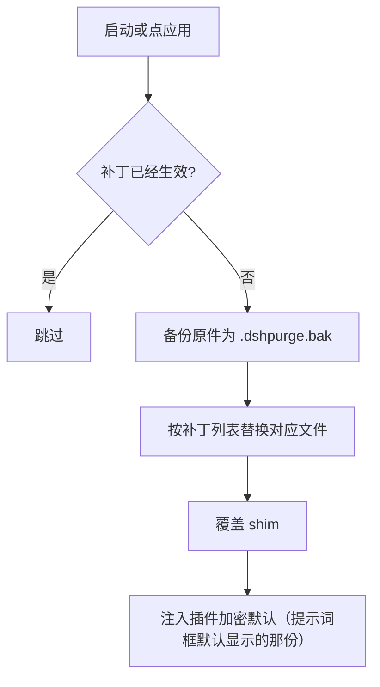
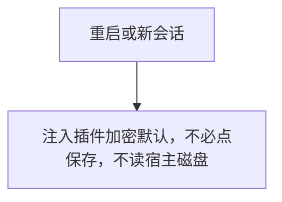
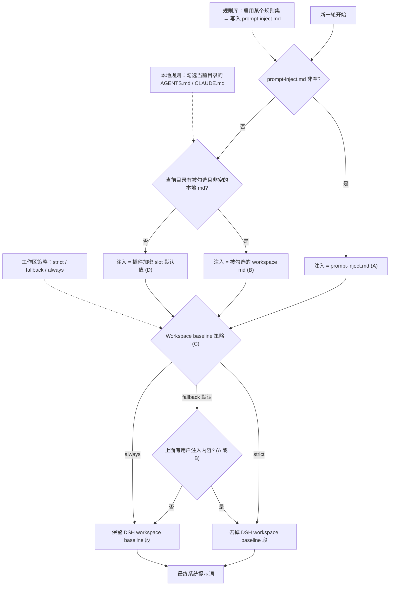

<p align="center">
  
</p>

<h1 align="center">⚔️ DeepSeek Harness 网络安全红队工具（dsh-purge-safe）</h1>

<p align="center"><strong>Version 2.0.0</strong></p>

<p align="center">
  <em>满血版本 + Super Agent 适配 · DSH 0.2.2-rc.5 · 优化提示词，降低拒绝率，提升稳定性。</em>
</p>

<p align="center">
  <a href="./LICENSE"></a>
  <a href="https://www.deepseek.com/harness/"></a>
  <br>
  
  
</p>


<p align="center">
  <a href="README.md">English</a> | <a href="README.zh-CN.md">中文</a> | <a href="README.ja.md">日本語</a>
</p>

## 社区交流与技术支持

欢迎加入 Telegram 社区，获取项目动态，参与学习和交流、获取技术支持，也欢迎分享项目，让更多人了解并参与。

- **频道**: [LLM_PoJia](https://t.me/LLM_PoJia)
- **交流群**: [xiaomajiang9919](https://t.me/xiaomajiang9919)

## 目录

- [更新内容](#更新内容)
- [介绍](#介绍)
- [署名要求](#署名要求)
- [许可证](#许可证)
- [适配范围](#适配范围)
- [安装](#安装)
- [使用](#使用)
- [工作原理](#工作原理)
- [还原](#还原)
- [更新](#更新)

---

## 更新内容

**满血版本 + Super Agent 适配**

- 适配 **DeepSeek Harness 0.2.2-rc.5**。
- 新增 **Super Agent**。
- 优化提示词。
- 降低拒绝率，提升稳定性。

## 介绍

**dsh-purge-safe** 是装在本机官方 [DeepSeek Harness](https://www.deepseek.com/harness/) 上的网络安全红队评测插件。本次为**满血版本 + Super Agent 适配**，面向 **DSH 0.2.2-rc.5**，新增 **Super Agent**，优化提示词、降低拒绝率并提升稳定性。支持官方 **Web**（`dsh web`）和官方**桌面端**（EXE），两边分开安装、分开应用。

Harness 不只是把问题交给模型。它还会在运行时改提示词、审批门、沙箱和会话格式。只看「模型答不答」，会把宿主拦截误当成模型拒绝。这个插件在你自己的安装里把这两层分开，用来做受控评测，也用来看默认策略该不该收紧。


| 你会用到             | 它做什么                                            |
| ---------------- | ----------------------------------------------- |
| **dsh-purge-safe 侧栏** | 会话标题旁的按钮打开右侧栏。里面两页：清洗、演练台                       |
| **清洗**           | 分组查看补丁，应用、还原、卸载；编辑提示词和多套规则                      |
| **演练台**          | 正式版内置。授权后查看资产和本机环境。技能库与知识库随包提供。 |
| **宿主策略**         | 调整默认文案、权限策略和工具上限。官方能力保留，不另写一套身份                 |
| **启动时** | 本地版默认关闭自动应用；在「清洗」中点击「应用」，按需配置启动时重新应用。 |


不写死盘符。按 `$DSH_HOME`、dsh 启动器旁边的 `.dsh`，再退回 `~/.dsh`。不改 Harness 源码仓库，在 **dsh-purge-safe** 的「清洗」里点「应用」才写入。身份来自插件里的加密提示词，也就是提示词框默认显示的那一份。不读取宿主磁盘上的提示词文件。

本插件只处理使用者本机已安装的官方 `@deepseek-ai` 包和本机配置。它不是公网扫描器，也不是针对第三方站点的攻击套件。仓库内不含木马、未授权渗透脚本或对外攻击载荷。

---

## 📌 原版禁止倒卖。二开必须署名。

## 署名要求

**原版禁止倒卖。** 不得付费转售、换皮上架，或以商品形式分销。

**二开必须署名**，并写明来源仓库：[dsh-purge-safe / CallMeGuLab](./NOTICE)。借用本项目的名称、思路、代码或提示词，同样必须署名。

不署名、隐瞒来源、改头换面据为己有，或把原版拿去倒卖，维护团队将依法追究责任。

## 许可证

本仓库使用 [Apache License 2.0](./LICENSE)。二开、再分发必须保留版权声明和 [NOTICE](./NOTICE)，写明来源 [dsh-purge-safe / CallMeGuLab](./NOTICE)。原版禁止倒卖。

---


### ⚠️ 严正法律免责与合规使用声明


**免责声明：** 本项目为非营利开源项目，遵守国家法律法规及所在平台的相关规范，仅供学习与研究使用。不得将本项目用于任何违法违规用途；由此产生的后果由使用者自行承担。

**【零容忍严正申明】**：本项目坚决反对并严禁任何形式的违法犯罪行为！本维护团队绝不支持、不鼓励、不协助任何未授权网络攻击、漏洞利用、数据窃取、非法侵入计算机信息系统或生成违法违禁内容的活动。**任何将本项目用于违法犯罪的行为，均与本维护团队无关，由行为人依法独立承担全部法律责任。**

1. **本仓库不含违法内容**：`dsh-purge-safe` 发布的代码、文档、补丁与默认提示词**不是**木马、后门、未授权渗透工具、勒索软件、撞库脚本，也**不是**针对公网或第三方系统的攻击载荷。项目本身不提供违法内容，也不教唆、组织、协助实施违法犯罪。
2. **只作用于本机官方 Harness**：安全评测补丁、提示词注入全部发生在使用者**本机已安装的官方 DeepSeek Harness**（`@deepseek-ai` 包、本机 profile / `$DSH_HOME`）上。对象是使用者自己的官方本地软件，**不是**他人的网站、服务器、账号或信息系统。
3. **评测补丁不对外网目标联网**：应用补丁、写入注入、回滚、卸载均在本机文件与本机进程内完成，**不对任何公网主机、未授权系统进行扫描、探测、入侵或攻击发包**。不得把本项目当作跳板去打外网。当前本地固定版本已关闭在线更新，也不能被解释为授权对外渗透。
4. **合法受控范围限定**：本项目定位为使用者在**自己有权管理的本机官方 Harness**上，进行红队科研与鲁棒性评测的辅助工具。**严禁在未经所有者合法书面授权的目标、公网在线系统或生产业务上运行本项目**。一切测试必须限制在**本机已授权安装的官方 Harness、离线本地合成靶标、授权网络安全演练靶场及合规实验室受控环境**中进行。
5. **严禁违法与违禁用途**：使用者严禁利用本项目直接或间接从事任何违反下列法律法规的行为（必须逐条遵守，不得以任何理由规避）：
  - **《中华人民共和国刑法》**
  - **《中华人民共和国网络安全法》**
  - **《中华人民共和国数据安全法》**
  - **《中华人民共和国个人信息保护法》**
  - 以及其他现行有效的法律、行政法规与监管规定；
  - 同时严禁：
  - 未经授权渗透、攻击公私机构计算机信息系统，实施勒索、破坏、撞库或传播恶意载荷；
  - 诱导、生成或传播危害国家安全、恐怖主义、暴力血腥、涉黄涉赌、诈骗、侵犯公民隐私或知识产权等任何法律明令禁止的违法违禁内容；
  - 违反相关大模型提供商的《服务条款》与《滥用政策》。
6. **使用者独立承担全部责任**：本项目依据 Apache-2.0“按现状”提供，维护团队不对软件的完整性、安全性与适用性作任何明示或暗示的保证。**使用者应对自身的所有下载、部署、运行、修改、传播行为以及由此产生的全部输入与输出后果承担独立、完全的民事、行政及刑事法律责任**。维护团队与所有贡献者绝不承担任何因使用者滥用导致的直接、间接或连带责任。
7. **违约即终止授权**：任何将本项目用于非法攻击、恶意活动或违规行为的个人或实体，其开源软件使用许可将自违法违规行为发生之日起**自动且不可撤销地立即终止**。该主体须立即停止使用并永久销毁本项目的所有代码、脚本与衍生数据，并依法承担相应法律制裁。
8. **第三方独立性声明**：本项目属于完全独立的开源安全评测研究项目，与 DeepSeek 官方或其关联主体无任何隶属、商业合作、授权或官方背书关系。文中「官方」仅指评测对象为使用者本机安装的官方 DeepSeek Harness 软件包，**不代表** DeepSeek 官方开发、认可或担保本插件。
9. **必须署名**：借用本项目的名称、思路、代码或提示词，必须署名并标明本仓库。不署名将依法追究责任。详见 [署名要求](#署名要求)。


---

## 适配范围

本次适配 **DSH 0.2.2-rc.5**，包含 **Super Agent** 适配。支持官方 Web 与官方桌面端，两边分开安装、分开应用。

宿主原文对不上时，补丁会显示待应用或跳过，不会盲目改写文件。

---

## 安装

将当前压缩包解压到名为 `dsh-purge-safe` 的本地目录，只安装到你实际使用的宿主。

```sh
# 官方 dsh web：将路径换成实际解压目录
dsh plugin --profile web add /absolute/path/to/dsh-purge-safe

# 官方桌面 EXE
dsh plugin --profile desktop add /absolute/path/to/dsh-purge-safe
```

完全退出并重新打开对应宿主，点击会话标题旁的 **dsh-purge-safe → 清洗 → 应用**。应用成功后自动重启一次；在聊天中执行 `/purge status`，确认宿主目录和补丁状态。

<a id="manual"></a>

### 手动安装

1. 找到实际使用的 `$DSH_HOME`，其中应包含 `profiles/web` 或 `profiles/desktop`。
2. 将解压后的插件放到 `$DSH_HOME/plugins/dsh-purge-safe`。
3. 只在对应 profile 的 `package.json` 中追加：`dependencies` 增加 `"dsh-purge-safe": "file:../../plugins/dsh-purge-safe"`，`dsh.profile.bundles` 增加 `"dsh-purge-safe"`。保留原有配置。
4. 进入该 profile 目录执行 `pnpm install`，确认 `node_modules/dsh-purge-safe/package.json` 存在。
5. 完全退出并重新打开宿主，再点击「清洗 → 应用」。

卸载时使用「清洗 → 卸载」或 `/purge uninstall`。当前压缩包使用本地安装，不包含远程仓库安装地址。

---

## 目录结构

`bin/` 是命令行，`lib/` 是补丁和演练台，`presets/redteam/` 是红队预设，`skills/redteam/` 是随包技能，`client.js` 是侧栏。

运行时文件在 `$DSH_HOME`：`prompt-inject.md`、`rules/`、`skills/`、`redteam/`。未设 `DSH_HOME` 时，优先用 dsh 安装目录旁边的 `.dsh`，再退回 `~/.dsh`。Web 和桌面端各用自己那一份主目录。

---

## 使用

```sh
# CLI
dsh-purge-safe --status
dsh-purge-safe --apply
dsh-purge-safe --revert
dsh-purge-safe --uninstall
dsh-purge-safe --edit

# 聊天
/purge status | apply | revert | uninstall | edit | help
/rules list | use <id> | create <id> | delete <id> | reset | help
/rewind

# 其它插件已占 /rewind（或 /purge、/rules、/skills）时，这条命令会跳过或改挂
# /purge-rewind 等备用名；主插件其余命令、工具、/dsh-purge-safe/* 路由不受影响。

# 模型工具
purge_status   purge_apply   purge_revert
```

「应用」成功后会自动重启，以加载已改的包文件；也可手动点击「重启」。当前为本地固定版本，在线更新、切换通道和联网回退已关闭。

输入框旁的「回退一次」和「回退上一轮」都留在当前这条对话里，不另开分支。已发送的那句会回到输入框，这一轮已经发出的内容和已完成的任务会从当前对话撤掉，改字后**重新发送**即可。多轮对话后回退按**当前这一轮**定位，不会又退到第一条用户消息。聊天里 `/rewind` 同样可用。

**极简 / PTC 与标准不一致时**：同一任务在标准模式能跑、在极简或 PTC 被拦，通常是 preset 里 `run_code` 或 plan 拦截句没洗净，或内置 minimal 缺少 `agent-instructions`。请升级到最新版，**完全退出宿主 → 清洗里应用 → 自动重启 → 新开一轮对话** 再试；只换 preset 不重应用，旧进程里的补丁不会更新。

### 响应速度

DSH 会按顺序执行同一批中的 Bash 调用。旧版 dsh-purge-safe 把默认前台等待从 60 秒提高到了 10 分钟，一条慢命令会让后续调用一起等待。补丁 #21 现在把带插件标记的旧值恢复为官方的 60 秒。无标记的等待时间和其他自定义值会保留；无标记的 10 分钟无法可靠地区分是插件旧值还是用户设置。

在 macOS/Linux 的 `dsh web` 中，如需更快返回工具结果，可在 `$DSH_HOME/profiles/web/cordis.patch.yml`（通常是 `~/.dsh/profiles/web/cordis.patch.yml`）添加下面的条目。已有相同 id 时修改原条目，不要重复添加。这个 profile 覆盖层在内置配置之后加载，后续应用插件会保留它。

```yaml
- id: bash-sandbox
  config:
    timeoutMs: 10000
```

使用标准 jobs 服务且 `promoteOnTimeout: true` 时，未完成的命令会在 10 秒后返回后台任务 id，并继续运行。用 `job_output` 读取结果、用 `job_kill` 停止。这个设置缩短前台等待，不会让命令本身跑得更快。没有 jobs 服务或关闭自动转后台时，超时会终止命令。单次调用传入的 `timeoutMs` 优先于这里的默认值；`run_in_background: true` 可立即返回任务 id。

日常任务还可以选择让新会话默认使用 Low 推理：

```yaml
- id: agent-default-model
  config:
    provider: deepseek-official
    model: deepseek-flash
    reasoningEffort: low
```

重启 `dsh web` 后加载配置。模型和推理等级默认值只用于新建会话，已有会话请在输入框中选择 Low。插件不会自动修改这些模型偏好。需要深入推理的任务可保留 High；搜索文件时应限定目录，避免递归扫描所有应用目录。

### 本地靶场

禁止对中国大陆、香港、澳门，银行与金融站点，政府与军事站点发起渗透、攻击或扫描。

---

## 本地校验

```sh
node --check lib/index.js
node --check lib/core.js
node --check lib/rewind.js
node --check lib/skills.js
node --check client.js
```

---

## 工作原理

应用，启动时或手动点「应用」：




每次会话的覆盖：




每一轮的提示词注入与规则集决策。左边三个输入就是你在 dsh-purge-safe 面板里控制的东西，虚线表示它们各自驱动哪一步判定：




---

## 还原

- 每个目标文件在应用前备份为 `<文件>.dshpurge.bak`。
- 「还原」或 `/purge revert` 用备份覆盖回去并删除备份；没有备份时去掉 shim 里由本插件写入的行。
- `prompt-inject.md` 是用户文件，还原时保留。
- 「卸载」会先还原（若已应用），再删除注入文件、规则库和插件本身。
- 重复应用是幂等的。

---

## 路径探测

宿主面先判断 `web` / `desktop`（预留 `gui` / `tui`，尚未单独适配时回退 web）。

**Web：**

1. `DSH_HOME` / `DSH_BASE`
2. dsh 启动器旁的 `.dsh`
3. `npm prefix -g` / `npm root -g`
4. 嵌套 `@deepseek-ai/dsh/node_modules/@deepseek-ai`
5. 系统默认 `~/.dsh`

**官方桌面：** 只改当前正在运行的官方桌面安装。点「应用」成功后会自动重启一次。社区桌面端不维护。

找不到目标时提示设置 `DSH_BASE`，不改文件。

---

## 更新

本次更新说明见 [release-notes.md](./release-notes.md)。后续更新通过替换本地压缩包完成；版权与来源署名见 [NOTICE](./NOTICE)。

## 说明

- 改动范围是本机 `@deepseek-ai/*` 包里的渲染文案、默认策略和执行逻辑，以及用户目录下的覆盖文件与规则集。
- 升级后原文对不上会显示跳过，这次应用仍算完成，不会乱改。
- 不改动非 `@deepseek-ai` 的第三方插件源仓库（启动时的 CMD 无感会**尽力**修补已装的 doctor / market / dsh-liangshen / mnemon，属运行时补丁）。
- 使用解压后的本地目录安装，见[安装](#安装)。Web 与桌面端使用各自的 profile。

---

感谢 [LINUX DO](https://linux.do) 社区
