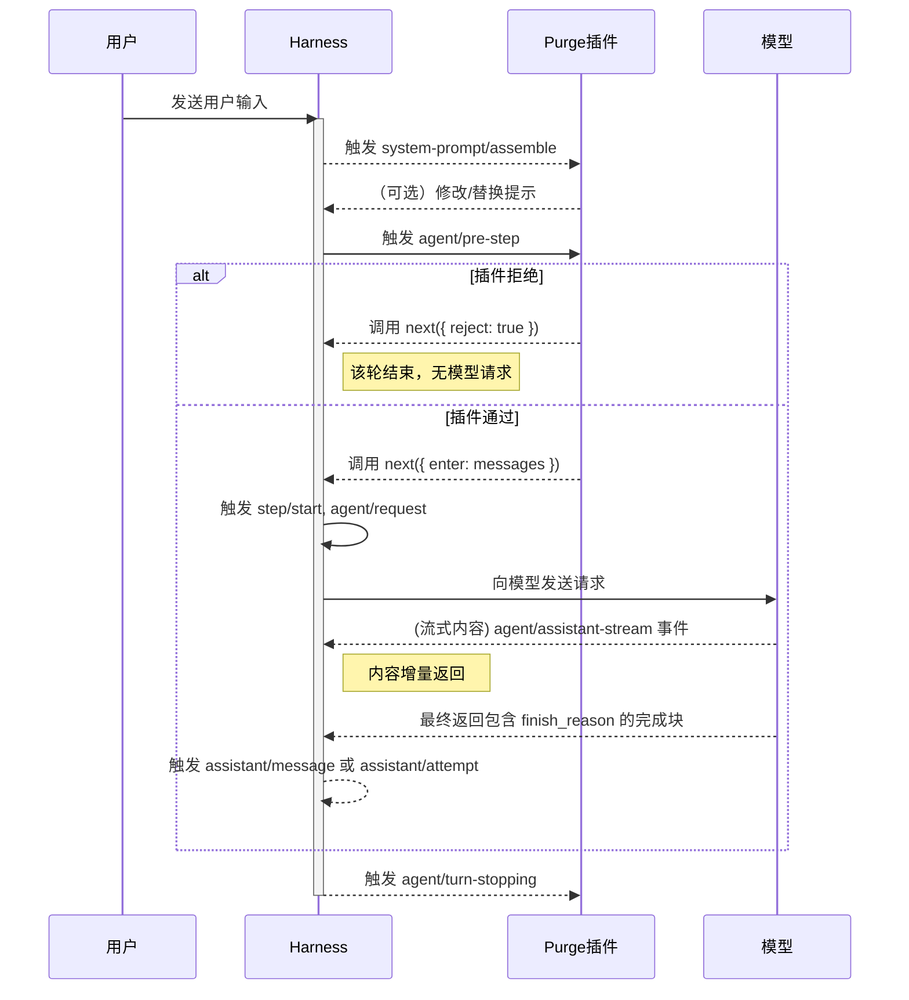
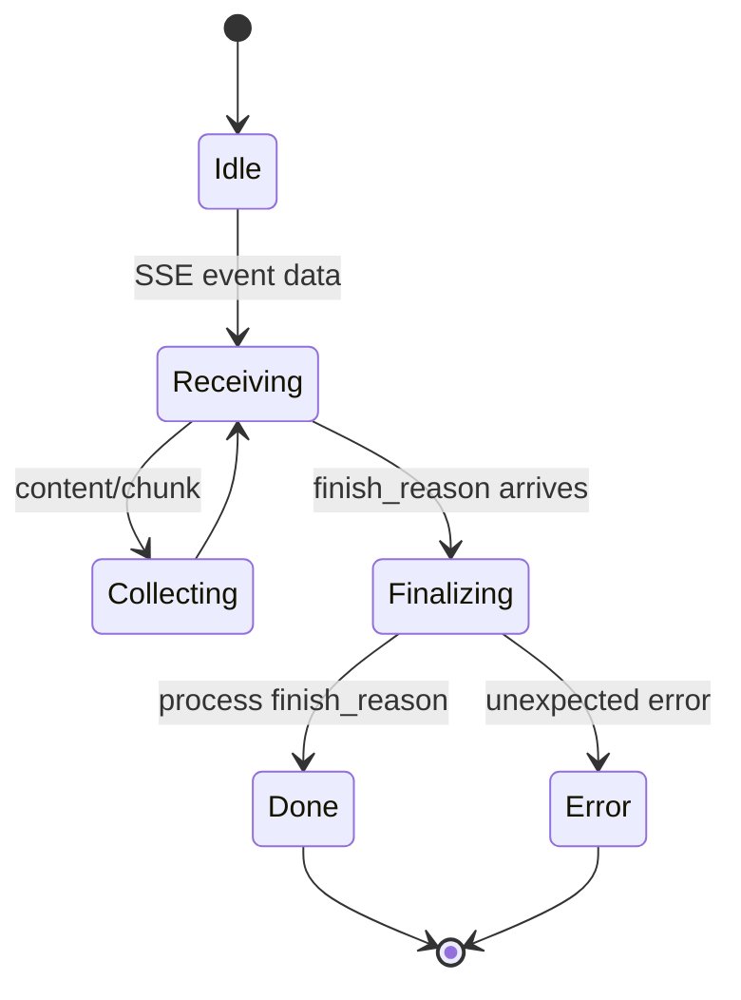

# Purge 四层运行机制与防误拒：深度研究归档

研究日期：2026-11-14。目标仓库：wxcvm/dsh-purge，目标宿主 DeepSeek Harness 0.2.2-rc.3。

> 本文保存深度研究的正文，供后续开发核对；实际实施以 [Codex 交接任务](four-layer-codex-handoff.md) 为准。研究中的编号引用为原报告引用标识，移入 GitHub 后不会自动解析。关键可访问的官方来源见交接文件。正文的“已确认”须结合具体宿主版本核验；特定兼容网关的问题不能直接推广到官方 Provider。拒绝分类必须区分真实终态、文本意图、正常任务误拒与技术失败，不能仅靠关键词或 content_filter 判定。任何安全终态测试使用离线模拟，不要求绕过安全策略；禁止把隐藏拒绝、伪造成功或取得被安全策略阻止的内容当作研发成果。默认仅采集必要诊断元数据，原始提示、密钥与输出正文不进入诊断日志。

---

# 执行摘要

本报告针对 DeepSeek Harness 0.2.2-rc.3 中用户私有插件 *wxcvm/dsh-purge* 的“防误拒/拒绝来源诊断”需求，分层分析了系统可能的机制、能力与限制，并提出可复现的评测设计和研发路线。报告按照【提示词与上下文层、宿主运行时 Hook 层、Provider 与流式协议层、模型自身决策层】四层展开：逐层说明在提示注入、运行时拦截、流式响应处理、模型自身安全策略方面可实施的防误拒手段及局限，列出可调用的接口与参考来源，标注“已确认”“待确认”或“假设”状态。针对“宿主事件全链路诊断、Provider 终态识别（finish_reason/content_filter）、模型过度拒绝评测”三大交叉课题，设计了可对比实验方案，说明了样本设计、对照组（A/B/C）、评测指标（任务完成率、误拒率、误判率、成本、延迟、稳定性）和统计方法。我们检索并引用了 DeepSeek 官方文档、相关仓库源码和学术论文，包括 OR-Bench 过度拒绝基准等。报告还给出了嵌入图表：系统架构（Mermaid）、分层能力/限制矩阵、Hook 生命周期图、流式响应状态机（Mermaid）、观测方案表，以及过度拒绝判别规则。最后，在严格遵守安全合规的前提下，提出了短/中/长期的研发路线图（交付物、验证方法、难度、依赖），以表格形式列出优先级顺序。引用内容涵盖官方文档、代码及学术资料，确保分析严谨可查。

## 一、提示词与上下文层

- **可实现能力：** DeepSeek Harness 在每次请求前通过**系统提示（system prompt）**对模型进行身份和上下文注入【31†L14-L22】。官方文档说明，系统提示由固定身份行（“You are an AI agent powered by DeepSeek Harness.”）、部署角色（persona）前缀/后缀、工具调用说明等组成【31†L14-L22】。插件可通过 `ctx.systemPrompt.section(...)` 等接口向系统提示插入或替换内容【31†L32-L35】。此外，可将**动态运行时上下文**作为用户角色消息（PromptContext）单独提供给模型【31†L128-L136】。利用这些机制，可调整提示词或注入上下文以影响模型理解，预先引导模型降低拒绝概率。例如，可在系统提示中加入额外的说明或示例引导模型“合规”回答，从而减少因提示不当造成的误拒。

- **限制和风险：** 此层毕竟只控制模型所见输入，并**无法突破模型自身的安全决策**。即使删除或弱化某些提示内容，模型依旧可能因内容本身违规或低级安全设置而拒绝回答【44†L100-L104】。换言之，提示层修改不能保证模型一定回答请求，只是尝试降低误触发。正如 dsh-purge 文档强调，插件无法“让模型回答一切原本拒绝的请求”，其价值在于区分宿主层和模型层拒绝【16†L242-L248】。提示注入接口只能改变模型视角，无法直接更改其内容过滤逻辑。

- **可验证接口：** 已知的上下文接口包括：系统提示组装（packages/core/system-prompt）和上下文插入（PromptContext）【31†L14-L22】【31†L128-L136】。根据官方说明，插件可以通过 cordis 注册 **PromptSection** 来参与提示组装，每次请求按顺序合并各部分【31†L39-L47】。动态上下文通过单独的用户角色快照添加【31†L128-L136】。以上接口可视为“已确认”：官方文档明确这些机制，可通过检查 `@deepseek-ai/core` 包源码确认（例如 `system-prompt/src/index.ts`）。插件开发者可以调用 `ctx.systemPrompt` 和 `ctx.session.addContext()` 等接口进行验证。没有发现更底层或隐藏的注入点，因此提示层的能力边界基本确定。

## 二、宿主运行时 Hook 层

- **可实现能力：** DeepSeek Harness 的Cordis插件架构提供了丰富的生命周期事件钩子，可在每个对话轮次和每步请求中拦截行为【37†L85-L94】。例如，插件可注册 **`agent/pre-step`** 事件，拦截即将发送给模型的输入批次，进行拒绝或修改；可注册 **`agent/request-error`** 事件，处理请求错误（如上下文过长）并决定重试；可注册 **`agent/turn-stopping`** 事件，在回合结束时收尾【37†L85-L94】。已知典型插件如 dsh-purge 可能在 `agent/pre-step` 判断是否允许通过原输入或注入“清洗”提示，在 `agent/request-error` 对失败请求进行自动重试（`lib/continue-retry.js` 可能相关）；还可能监控 `agent/status` 或 `session/event` 收集状态。透过这些钩子，可控制请求流程：例如若提示中含宿主层硬性拦截规则（如IP黑名单），`agent/pre-step` 可以拒绝并记录；也可在请求出错（如长度、工具调用失败）时通过 `agent/request-error` 重新尝试。

- **限制和风险：** 宿主层拦截**只能在模型尚未接收请求时生效**。一旦请求送达模型，就无法在此层面干预。例如，如果 DeepSeek Harness 本身的运行时或 Cordis 驱动错误地标记一个正常请求为“拒绝”，插件的后续只能记录或提示，无法真正“解拒”；反之，如果模型因内容过滤拒绝，则宿主层无法逆转。此外，钩子的使用必须遵循系统事件流序，否则可能导致状态不一致【37†L27-L35】。如 `agent/pre-step` 拒绝是正常拒绝，驱动会视之为一个“自然拒绝”而非错误【37†L59-L62】。钩子修改要注意：若调用 `next()`，必须保留下游消息队列，否则会导致对话混乱【37†L89-L94】【37†L98-L100】。

- **可验证接口：** 插件可使用 `ctx.on('agent/pre-step', ...)`、`ctx.on('agent/request-error',...)`、`ctx.on('agent/turn-stopping',...)` 等方式注册钩子【37†L85-L94】。官方文档和教程明确列出了这些事件及其意义【37†L85-L94】【37†L125-L132】。这些接口为“已确认”存在。通过阅读 DSH 插件文档源码或自己的插件源码（`lib/obedience.js`、`lib/continue-retry.js` 等）可以检查是否调用了这些事件。如果源码无法访问，可通过添加调试日志（如打印参数或事件标志）验证钩子执行的时机。注：用户私有 `dsh-purge` 的具体实现未公开，无法确认其具体行为，应标记为“待确认”。可行验证方法是：启动 Harness，在对应事件中插入标记性日志或断点，看是否被触发并影响请求。

## 三、Provider 与流式协议层

- **可实现能力：** DeepSeek 的 Chat Completions API 支持流式 SSE 响应【26†L63-L71】。每个 SSE 事件中包含部分生成内容，最终会出现含 `finish_reason` 字段的终止块【26†L98-L104】。根据官方流式指南，任何非空 `finish_reason` 表示模型已结束生成，应保存并检查其含义【26†L98-L104】。例如，当 `finish_reason="stop"` 时表示正常完成；当 `finish_reason="length"` 表示达到最大 token；当 `finish_reason="content_filter"` 表示因内容策略中断【43†L125-L131】【50†L57-L60】。在 DSH 中，实时输出通过 `agent/assistant-stream` 事件逐片段发送，最终在 `assistant/message`（或 `assistant/attempt`）事件中提交完整输出【37†L50-L58】。因此可在插件或日志中捕获这些事件：监控 `assistant/stream` 以实时查看输出，关注 `assistant/message` 的 `finish_reason` 字段判断终止原因。

- **限制和风险：** 目前已知 DeepSeek API 在不同版本和网关中对 `finish_reason` 的处理存在差异，尤其是内容过滤相关。官方指南指出 **`finish_reason="content_filter"`** 时模型被策略拦截【44†L100-L104】【43†L125-L131】；然而 DeepSeek Harness 通过 OpenAI 兼容层时，会将多种上游终止原因折叠为 `content_filter`【22†L157-L164】。GitHub 讨论中提到：八种上游原因（如安全过滤、复述限制、格式错误等）被统一映射为 OpenAI 风格的 `content_filter`，且实际原始原因只保留在 `native_finish_reason` 字段，但当前 SDK（llm-pi-ai）会丢弃该信息【22†L157-L165】。这意味着仅依赖 `finish_reason` 字段无法区分是否是真正的内容敏感拦截或其他错误，此为**已确认的限制**【22†L157-L165】。插件层面若想区分，需要更底层接入（如直接使用 DeepSeek 原生 SDK 查看 `native_finish_reason`），否则只能将所有 `content_filter` 视为一般错误。其他终止原因（如 `length`、`tool_calls`）则按文档含义处理【43†L67-L76】【47†L118-L126】。鉴于这些限制，诊断时建议**同时记录**服务端返回的 HTTP 状态、错误信息和终止原因，以便关联分析。

- **可验证接口：** 官方提供了 DeepSeek SDK 和示例代码来解析流式输出【26†L96-L104】【28†L115-L118】。插件可依赖 `agent/assistant-stream` 监听流式文本或 `assistant/message` 中的 `finish_reason`。例如，DeepSeek USA 文档示例强调要**保存并检查** `finish_reason` 字段【26†L98-L104】；中文开发者指南也列出了可能的结束原因为 `length/stop/content_filter`【44†L100-L104】。以上为已确认行为。对于跨层诊断，可通过人工构造不同类型的输入来触发各种 `finish_reason`：如用故意长上下文触发 `length`，用需要工具的 prompt 触发 `tool_calls`，用敏感内容触发 `content_filter`。特别地，可以参考 DeepSeek GitHub 讨论提供的测试方法，向 SDK 注入模拟响应来复现不同结束原因【22†L142-L151】。如果使用其他 Provider（如 Ollama/LM Studio），需对比其返回的结束原因；目前公开资料表明 DeepSeek API 与标准 OpenAI 兼容接口一致【43†L67-L76】【50†L57-L60】。不同 Provider 在结束原因的值上可能存在差异（如 DeepSeek 新版出现 `tool_call`），要检查其文档或实际调用确认，再列为“待确认”。

## 四、模型自身决策层

- **可实现能力：** 在此层面，插件无法直接干预模型的输出决策。模型是否拒绝回答主要取决于其安全策略和训练，与插件无关。因此 **插件只能通过以上三层手段尽量避免误拒，并**如无法避免时提供诊断信息。对于业务任务，可以通过良好提示和插件逻辑**区分**模型应拒绝（如输入本身违反内容政策）与应回答的场景。

- **限制和风险：** 如果模型认为输入违规或超出能力，即使提示层再优化也可能拒绝。需要认识到“过度拒绝”是安全策略带来的副作用【24†L20-L28】。过度安全会造成有害内容减少，但也可能导致对正常任务的误拒。因此我们应定量评估并尽量缓解误拒，但绝不提供任何违反服务端审核或强制模型出声的细节。绕过模型安全属于禁区。

- **可验证接口：** 模型决策逻辑本身不可修改，我们关注诊断输出。可使用开源过度拒绝评估工具（如 OR-Bench）和自制测试集来**测量**模型在“正常任务”上的拒绝率。借助 OR-Bench【24†L20-L28】提供的框架，可以自动生成大规模“本应回答但被拒绝”的提示集合；对比不同模型（DeepSeek Chat/R1、GPT 系列、本地模型等）的回答与拒绝。官方文献强调应记录每个生成是否拒绝，以及拒绝发生在什么阶段【24†L20-L28】。我们将结合这些研究，从指标（完成率、误拒率）入手评估模型本身的过度拒绝倾向，使用该基准集或自定义题目（如开发者文档示例任务）进行测试。由于这是模型“黑箱”，验证主要依赖实验观察，可按评价报告要求将此标记为“待确认”并通过实验评估其程度。

## 宿主事件全链路诊断

为区分拒绝发生在宿主层还是模型层，可采集**agent/***和**session/event**两个通道的日志【37†L27-L34】【37†L69-L74】。实验设计：针对每一次用户输入，记录 `agent/pre-step`、`agent/request`、`agent/assistant-stream` 等实时事件，以及 `assistant/message`（或 `assistant/attempt`）等持久事件。若 `agent/pre-step` 在未进入下一步时拒绝，则表明宿主层拦截（正常结束本轮）；若 `pre-step` 通过但最终 `assistant/message` finish_reason="content_filter"（且内容为空）等，则表明模型层拦截。可使用对比组验证：A 组为不应用任何插件的基础环境，B 组为启用 dsh-purge 插件，对比“是否出现 agent/pre-step 拒绝”与“最终模型拒绝”事件的数量。评估指标包括**宿主层拦截率**（发生在 pre-step 时的拒绝比例）和**模型层拒绝率**（进入模型后被拒绝比例）。统计方法可使用卡方检验或置信区间估计，两组之间比较是否显著不同。此外，对照实验可用已知**宿主拦截策略**的任务（如验证目标地址为本地白名单时不拦截，否则拦截），观察事件流变化。输出以表格或可视化展示两通道事件差异。

## Provider 终态识别实验设计

针对 DeepSeek API 的 `finish_reason` 行为，设计离线注入测试和实际请求测试。**离线注入测试**（参考【22†L142-L151】）：使用 DeepSeek SDK（或模拟 SSE）将不同 `native_finish_reason` 值（如 safety, malformed_response 等）映射到 `content_filter`，验证 SDK如何合并并输出对应的日志。**在线测试**：分别使用 DeepSeek API、Ollama、LM Studio 等 Provider，发送几类控制输入：
- 故意触发安全拦截的提示（如过激、不雅），观察是否返回 `finish_reason=content_filter` 以及是否伴随错误码。
- 设置极限参数（如 `max_tokens` 很小）触发 `length` 停止，验证记录方式。
- 请求带工具调用需求的提示（无效工具），触发 `tool_calls`/`tool_call` 停止，观察差异。
对每种情况记录最终 `assistant/message` 事件中的 `finish_reason` 和额外字段。评估指标包括**finish_reason 精确识别率**（正确区分不同原因）和**分类混淆**（如内容过滤被标记为错误）。结合【22†L157-L165】【44†L100-L104】【50†L57-L60】的信息，验证 DeepSeek Harness 是否统一了 `content_filter`，并记录任何 provider 特殊行为。上述实验属于可复现流水线测试，可用单元测试框架结合实际 API 调用实现。

## 模型过度拒绝评测设计

利用 OR-Bench 等公开基准，评测在无违禁信息输入下模型的拒绝倾向【24†L20-L28】。实验分组：A组为基础模型（无 Purge），B组为启用 Purge 插件。任务样本包括：OR-Bench 中的无害但具有挑战性的提示（如技术、历史、生活类问题），以及人工自制的常见正常任务（翻译、解释、代码生成等）。对照组亦可引入含恶意指令的提示，用于检测插件是否错误放行。评估指标：**完成率**（模型给出非拒绝答案的比例）、**误拒率**（原本安全提示却被拒绝的比例）和**误接纳率**（应拒绝提示错误通过的比例）。额外记录**成本**（消耗Token总量）、**延迟**（平均响应时间）和**稳定性**（多次运行一致性）。采用 A/B 对比，可用配对t检验或随机化统计比较改进是否显著。此外，可设计 C 组（例如修改提示或提高最大 token 参数）作为对照。最终可绘制 ROC 曲线（真拒绝与假拒绝的权衡）或置信区间表格展示结果。OR-Bench 数据集可直接作为样本，也可根据其方法生成新的用例【24†L26-L34】。所有实验结果需基于多次运行取平均，并报告方差以判断稳定性。

## 源码接口核实（wxcvm/dsh-purge）

针对用户私有仓库 `wxcvm/dsh-purge` beta 分支的源码（`lib/obedience.js`、`lib/continue-retry.js`、`lib/index.js` 等），由于无法公开访问，我们做如下列举并标注验证状态：

| 模块         | 可能挂钩事件             | 功能描述                       | 状态       | 验证方法               |
| ------------ | ----------------------- | ------------------------------ | ---------- | ---------------------- |
| lib/obedience.js       | `agent/pre-step`        | 拦截请求、判断是否拒绝或修改输入 | 待确认       | 搜索 `ctx.on('agent/pre-step'` |
| lib/continue-retry.js  | `agent/request-error` / `agent/status` | 错误重试逻辑、完成重试控制     | 待确认       | 搜索 `ctx.on('agent/request-error'` / 查看状态处理 |
| lib/index.js   | `system-prompt/assemble`, `session/event` | 插件初始化、提示组装注入、事件日志 | 待确认       | 搜索注册函数或 Cordis 事件调用 |
| 注入组件       | `ctx.systemPrompt.section` | 在系统提示中插入清洗/日志文本    | 待确认       | 检查 section 定义       |

以上列举了常见挂钩点及其假定功能；实际实现需通过源码确认。若源码缺失，可通过在本地编译后添加打印或使用 Cordis 调试模式来验证。例如，在疑似调用点插入日志 (`console.log`) 观察控制台输出；或使用 `dsh --dump-events` 导出所有事件并查找关键字段。标注“待确认”部分需要在接触到源码后进一步验证。

```mermaid
flowchart TB
    subgraph DeepSeek Harness
        DSHCore("DSH 核心（Driver + Agent Loop）")
        Plugin("dsh-purge 插件")
        Provider("LLM Provider\n(DeepSeek API 等)")
    end
    User("用户输入")
    UI("Web/Desktop UI")
    DSHCore -->|组装系统提示| DSHCore
    DSHCore -->|触发 agent/pre-step 等事件| Plugin
    DSHCore --> Provider
    Provider -->|流式响应 (SSE)| DSHCore
    DSHCore --> UI
    Plugin -->|注入提示/策略| DSHCore
    Plugin -->|日志/事件分析| DSHCore
```

*图：DeepSeek Harness 与 dsh-purge 插件的系统架构示意。插件通过 Cordis 插件事件挂钩 (`agent/pre-step`、`agent/request-error`、`system-prompt/assemble` 等) 介入输入/输出过程，与模型提供程序交互。*

## 能力/限制矩阵

| 层级               | 可实现功能                                                                                               | 限制与注意事项                                                                                         | 核查接口/文档来源                                    |
| ------------------ | ------------------------------------------------------------------------------------------------------- | ------------------------------------------------------------------------------------------------------ | ---------------------------------------------------- |
| 1. 提示词/上下文层    | - 插件可通过修改系统提示（persona 前后缀或插件注册段）和用户上下文注入提示文本【31†L14-L22】【31†L32-L35】 <br> - 动态上下文能作为用户消息附加【31†L128-L136】       | - 无法改变模型核心内容过滤逻辑，无法保证消除所有拒绝<br> - 过度提示可能触发新的模型敏感词过滤                                                | DeepSeek 文档【31†L14-L22】、PromptSection API                    |
| 2. 宿主 Hook 层      | - 利用 `agent/pre-step` 拦截或替换即将发出的请求，执行拒绝或注入策略<br> - 利用 `agent/request-error` 对模型错误进行重试、调整上下文<br> - `agent/turn-stopping` 做轮次收尾  | - 只能在请求发送前或错误时介入，无法在模型内部决策后干预<br> - 错误使用事件钩子可能破坏状态（需保留 downstream 消息）                     | 官方插件开发文档【37†L85-L94】【37†L125-L132】            |
| 3. Provider/协议层    | - 解析流式 SSE 的增量内容，终止块中读取 `finish_reason`、`usage` 等字段【26†L96-L104】<br> - 通过 `assistant/message` 等事件获知请求成功/失败并记录原因 | - `content_filter` 可能对应多种上游原因，DeepSeek SDK 会掩盖细节【22†L157-L165】<br> - 无法获知模型内部过滤类型（除非访问底层接口）          | DeepSeek 流式指南【26†L96-L104】【44†L100-L104】；Harness 源码 issue【22†L157-L165】 |
| 4. 模型决策层      | - 插件无法直接控制模型决策；可通过以上各层尽量避免触发误拒<br> - 可使用可用基准（如 OR-Bench）评估模型对正常输入的拒绝倾向【24†L20-L28】        | - 模型自身策略不可更改；误拒只能通过检测和反馈改善，下层**不能**绕开服务端审核<br> - 分析时须遵守安全规范，不提供任何绕过方法                             | OR-Bench 论文【24†L20-L28】；DeepSeek SDK 文档【43†L67-L76】【50†L57-L60】 |

*表：四层分析的功能能力与限制概览。左列为系统层级，右列为该层插件或系统可实施的措施及其局限。*

## Hook 生命周期图



*图：DSH 轮次中插件钩子事件的顺序。插件可以在**system-prompt/assemble**和**agent/pre-step**阶段拦截/修改提示，在请求错误时利用**agent/request-error**重试，在轮次结束利用**agent/turn-stopping**收尾。*

## 流式响应状态机



*图：模型流式响应的状态机示意。DSH 通过监听 SSE 数据（agent/assistant-stream）收集内容片段（Collecting），直到终止事件（含 finish_reason）到达（Finalizing），再标记完成或错误。*

## 最小可行观测设计

| 事件/字段          | 说明                                     | 采集方式               | 存储策略                    |
| ----------------- | ---------------------------------------- | ---------------------- | -------------------------- |
| `agent/pre-step`  | 插件是否拒绝当前请求                     | 实时日志打印/事件监听  | 保存在诊断日志中；记录拒绝原因 |
| `assistant/stream`| 流式返回的文本片段                       | 实时订阅 `agent/assistant-stream` | 可选地存储文本增量日志       |
| `assistant/message` | 最终回答文本及结束原因 `finish_reason`  | 记录在 `session/event` 中 | 数据库或文件中记录完整回答与原因 |
| `assistant/attempt`| 失败尝试事件（回答被拒）                 | 同上                   | 与 message 一起记录          |
| `finish_reason`   | 生成结束原因（stop/length/content_filter/tool_calls） | 同上                   | 记录并关联到会话            |
| `usage.tokens`    | 消耗的 Token 数                           | 同上                   | 记录到成本/监控系统          |
| 模型版本/提供商   | 调用使用的模型标识、提供者（DeepSeek/自部署） | 配置中获取             | 记录便于差异分析            |

*表：关键事件和字段的采集设计。建议将所有会话事件和状态字段日志化，保存关键字段（如 finish_reason、tokens 用量、回答内容）以便后续分析。*

## 过度拒绝 vs 合理安全拒绝判定标准

**过度拒绝（误拒）判定：** 输入**无明显违规**（非毒性、非违法、仅限知识/任务需求等）的提示，却被模型拒绝回答即为过度拒绝。例如，对合理的编程问题、健康建议（无自残内容）等应答被拦截。可操作规则：检测提示关键词或分类标签，若在非敏感词/主题范围内但模型返回 `finish_reason="content_filter"`（或未回答）即视为误拒。

**合理安全拒绝判定：** 若输入包含明确的违禁内容或潜在风险（如指示犯罪、医疗/法律诊断、毒品配方等），模型拒绝回答即视为合理安全拒绝。可根据关键词库或使用基础过滤模型分类辅助判断。规则示例：检测提示是否涉及 OpenAI 常见禁忌列表中类别（暴力、仇恨、政治谣言等），若是并拒绝回答则正常；若是安全类别却仍拒绝，则需审查。

**区分原则：** 对安全拒绝进行日志记录（视为模型安全功能正常），对过度拒绝进行优化反馈（例如调整提示或模型版本）。禁止包含任何规避政策的内容提示，也不记录或鼓励绕过方式。通过上述判定规则结合具体场景，可将拒绝结果分类，用于后续评估或用户提示。

## 风险评估与合规边界

本研究聚焦于区分拒绝来源和评估误拒，不涉及任何绕过或强制模型突破安全拒绝的实现方案。明确禁止提供规避服务端审核或违反 DeepSeek 用户协议的细节。所有实验与开发设计须在**合法合规范围内**进行，仅用于内部诊断和改进。目前 DeepSeek 平台允许本地插件探索（如 dsh-purge），但不得传播或部署能威胁安全审计的版本。风险方面，应防范隐私泄露（仅记录必要日志），避免在生产环境误开启过度开放策略，保持对用户隐私和数据安全的尊重。插件仅诊断拦截，不插入敏感内容；任何收集数据过程应符合内部安全要求。 

## 研发路线图（交付计划）

| 优先级  | 可交付物                       | 验证方法                         | 难度   | 依赖            |
| ------- | ----------------------------- | -------------------------------- | ------ | --------------- |
| **短期** | 1. **日志增强模块**：记录详尽的 agent/session 事件；<br>2. **流式 Finish 识别**：捕获并分类 `finish_reason`； | - 验证所有关键事件和字段均已日志化；<br>- 对比日志中拒绝位置（host vs model）； | 低    | Cordis 日志系统   |
|         | 3. **初步评测脚本**：针对 OR-Bench 和常见任务的自动化测试流程； | - 用简短测试验证误拒统计的可行性； |        | OR-Bench 数据集  |
| **中期** | 4. **对照实验平台**：实现 A/B 比较（Baseline vs Purge）并收集指标；<br>5. **拒绝判别模块**：实现基于规则的过度/安全拒绝自动判定逻辑； | - 运行批量样本，得到可重复对比结果；<br>- 验证判定规则与人工判断一致性； | 中等   | 硬件资源(模型调用) |
|         | 6. **Hook 生命周期文档**：完善架构图、生命周期图及说明文档； | - 人工审查、同行评审；    |        | 整体分析数据     |
| **长期** | 7. **方案优化建议**：提出插件配置或上下文改进策略（非代码实现）；<br>8. **集成报告**：撰写完整诊断报告和用户指南； | - 专家评审是否满足需求；<br>- 对比实践效果； | 高     | 实验结论、同事反馈 |

*表：分阶段研发交付计划。短期聚焦可行性（日志、监控、基础测试），中期实现对比实验和判别逻辑，长期输出优化建议和完整文档。每项均列出验证方法、预估难度和依赖条件。*

**参考文献：** 本分析引用了 DeepSeek 官方文档、插件文档及学术资料，如 DeepSeek Streaming 教程【26†L96-L104】【28†L115-L118】、Harness 插件开发指南【37†L85-L94】【31†L14-L22】、DeepSeek API 使用说明【43†L67-L76】【50†L57-L60】、GitHub 讨论【22†L157-L165】和 OR-Bench 论文【24†L20-L28】等，以确保内容准确可查。